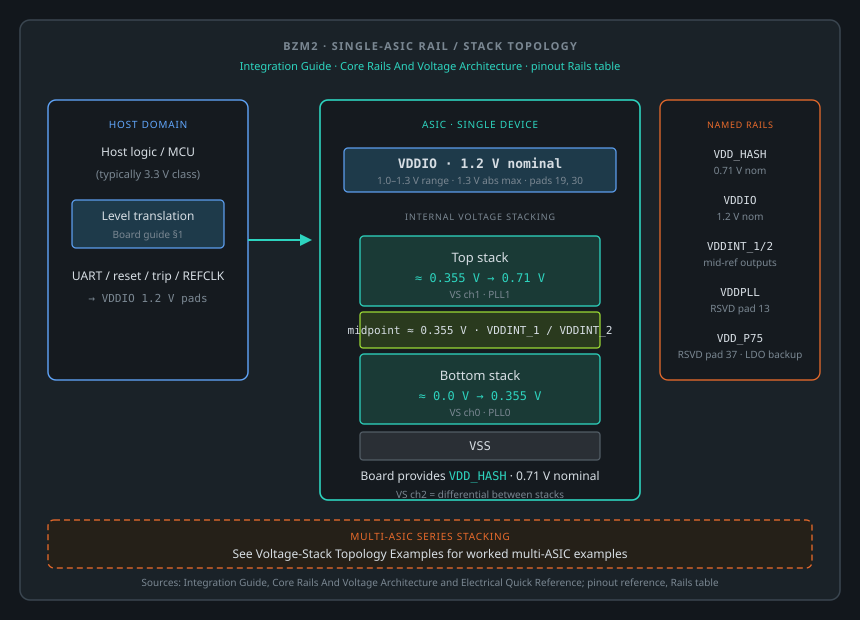
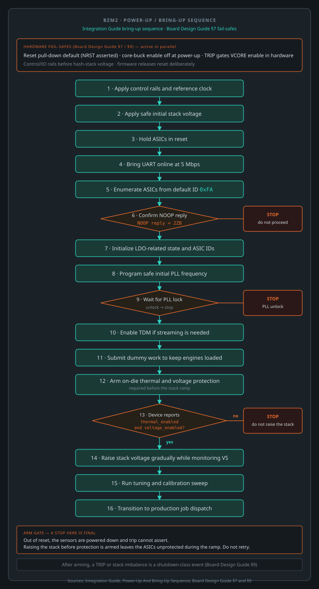
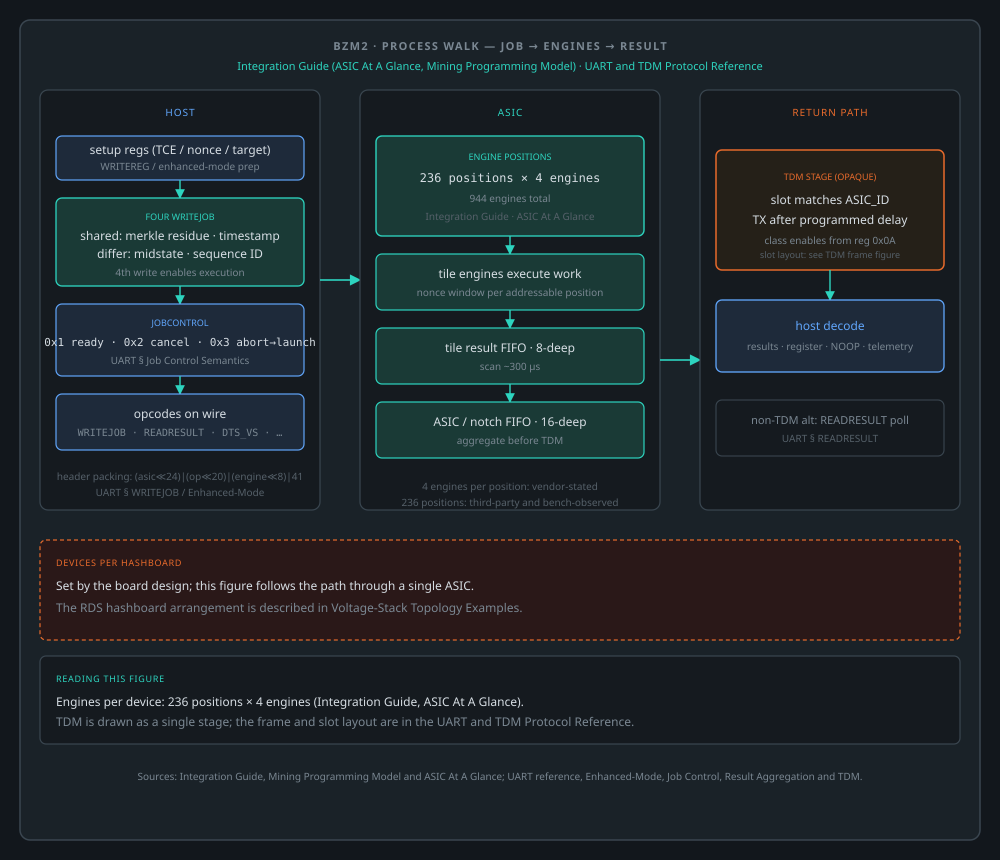

# Blockscale / BZM2 ASIC Hardware Integration Guide

## Purpose

This document consolidates ASIC-level behavior needed to design a custom
hardware solution around the Blockscale / BZM2 mining ASIC. It focuses on
generic implementation requirements:

- power architecture
- sequencing
- clocking
- UART transport
- multi-ASIC chaining
- telemetry
- protection
- tuning and calibration

It deliberately avoids copying vendor reference-board implementation details.
Those reference systems are useful examples, but they are not required for a
working design.

## Scope

This guide is for hardware developers building:

- a single-ASIC board
- a small multi-ASIC board with one or a few voltage domains
- a larger multi-ASIC platform with multiple voltage domains

The core constraint does not change with board size: every ASIC contains an
internal dual-stack engine arrangement and expects the host system to sequence,
clock, load, and protect it correctly.

## Terms Used In This Reference

| term | meaning |
| --- | --- |
| BZM2 | the Intel Blockscale 1000-series bitcoin mining ASIC (Bonanza Mine 2) |
| RDS | the vendor's reference mining system for the BZM2: three hashboards of 100 ASICs on one shared supply rail. The observed data in this reference come from one RDS unit |
| stock firmware | the vendor's own host software as shipped on the RDS, including its mining daemon |
| Mujina | open-source miner firmware; its BZM2 support is described under [Relationship To The Mujina Reference Firmware](#relationship-to-the-mujina-reference-firmware) |
| bottom stack, top stack | the two internal voltage domains of one ASIC, in series: bottom `0` to `~0.355 V`, top `~0.355` to `~0.71 V` |
| engine position (tile) | the unit an engine identifier addresses: `236` per ASIC, each holding four engines |
| TCE | the vendor's name for one hashing engine; the four engines at a position are its four lanes |
| enhanced mode | the default engine programming mode: four job writes per position, one per engine |
| notch | the vendor's name for the ASIC-level controller block; it holds the ASIC result FIFO, and its local registers are reached with engine identifier `0xFFF` |
| PLL, DLL | phase-locked loop (two per ASIC, one per stack) and delay-locked loop |
| DTS, VS | the on-die digital temperature sensor and voltage sensor; `DTS_VS` is the opcode and packet that carry both |
| TDM | the time-division multiplexed return stream: each ASIC transmits in the time slot that matches its ID |
| TRIP | the ASIC's over-temperature / over-voltage output, once the sensors are armed |
| FCLGA | flip-chip land grid array, the package type |
| PDN | power distribution network |

## ASIC At A Glance

ASIC-level properties:

- `236` addressable engine positions per ASIC `[BZM2-ENG-003]` - used by public
  open-source firmware and corroborated by bench capture
- `4` engines per position `[BZM2-ENG-005]` - vendor-stated; not independently
  measured
- `944` total engines per ASIC - the product of the two figures above
- `2` primary PLL domains, corresponding to the bottom and top engine stacks
- on-die digital temperature sensing
- on-die three-channel voltage sensing
- UART as the primary host control and mining transport
- unicast, multicast, and broadcast job/register distribution
- TDM streaming for results, register responses, `NOOP`, and sensor data

Throughput per ASIC can be estimated as:

```text
Throughput (GH/s) = 236 * 4 * PLL_Frequency / 3 * Pass_Rate
```

Where:

- `PLL_Frequency` is in GHz
- `Pass_Rate` is `0.0` to `1.0`: the fraction of the hashes that come back as valid results (see
  [Pass rate](#pass-rate))

Example:

```text
1.2 GHz * (236 * 4 / 3) * 1.0 = 377.6 gigahash per second
```

The example is arithmetic on the formula, not a measured rate. The formula is
useful for sizing cooling, PSU headroom, calibration targets, and per-domain
operating points.

Where the factor `4 / 3` comes from, and what of it is measured, is in
[Hashes per clock](#hashes-per-clock).

## Recommended System Partitioning

The ASIC does not require a specific vendor platform. It does require that the
overall system provide the following functions:

- stable control-side power
- stable stack-side power
- reference clock generation
- reset and trip handling
- UART master
- telemetry collection and protection logic
- work generation and result collection

The host connects to the ASIC chain through the UART master (control, work and results), the power path
(regulators, often over PMBus) and the cooling control (fans or pumps). The chain reports back through its
sensor stream (`DTS_VS`) and its `TRIP` output.

The exact split is your design choice:

- a Linux SoC can own all logic directly
- an MCU can own power sequencing while a host CPU owns mining
- an FPGA can assist with fanout, timing, or board aggregation

The ASIC-facing requirements remain the same.

## Package, IO, And Mechanical Constraints

Package and mechanical envelope:

- package size: `7.5 x 7 mm`
- package type: exposed-die molded `FCLGA`
- `60` lands: `40` peripheral plus a `20`-land inner field (see the
  [Pinout and Ball Map Reference](bzm2-pinout-reference.md))
- junction temperature limits: see the
  [Electrical Quick Reference](#electrical-quick-reference-per-asic)

Design implications:

- provide strong top-side thermal extraction
- assume continuous high leakage once stack voltage is present
- do not depend on reset state to keep thermal rise negligible
- plan for heatsink and forced airflow, or an equivalent thermal solution

Even a single-ASIC design should be treated as thermally active immediately
after hash rails are applied.

## Core Rails And Voltage Architecture

The ASIC is built around internal voltage stacking. The documents describe two
engine-stack ranges:

- bottom stack: approximately `0.0 V` to `0.355 V`
- top stack: approximately `0.355 V` to `0.71 V`

Additional named rails described in the vendor material:

- GPIO / control IO: `1.2 V`
- `VDD_HASH`: nominal `0.71 V`
- `VDD_P75`: backup rail if the on-chip LDO path is unavailable

### Rail and stack topology (single ASIC)



Single-ASIC rail topology, using the figures in the Electrical Quick Reference below and the pinout Rails table. For multi-ASIC series stacking, see [Voltage-Stack Topology Examples](bzm2-voltage-stack-examples.md): the RDS (25 levels × 4 in parallel) and the published bitaxeBIRDS (4s1p) and bitaxeBonanza (4s2p) designs.

### Why voltage stacking matters

Voltage stacking is central to efficiency, but it also creates the main
hardware risk:

- the absolute stack voltages must stay inside safe limits
- the differential between the stacks must stay controlled
- bad sequencing or poor balancing can create overvoltage or thermal runaway

The ASIC includes internal voltage sensing specifically because the host must
monitor and react to stack imbalance.

### Voltage sensor channels

The internal voltage sensor reports three channels. Getting their scales wrong
produces bounds that cannot fire, so read the healthy-reading column before
setting any limit:

| channel | what it measures | healthy reading | can it trip the ASIC? |
| --- | --- | --- | --- |
| `ch0` | differential across the **bottom** stack | `~355 mV` | **yes** |
| `ch1` | differential across the **top** stack | `~355 mV` | **yes** |
| `ch2` | top-stack return against bottom-stack supply - the **midpoint error** | small, near zero at idle, grows with load | **no** |

Both stack channels read the differential across their **own** stack, not an
absolute node voltage, so both sit near `355 mV` and are directly comparable
to each other. Public reference firmware programs the
**same** shutdown code into both channels and bounds their difference with a
single spread limit - neither would be coherent if the two were on different
scales.

`ch2` is **not** a third rail and is **not** the `~355 mV` step between the
stacks. It is also **not** `ch1 − ch0`. It is the gap between the bottom
domain's top and the top domain's bottom: near zero on a healthy part at light
load, but it grows with load current (it behaves like a resistive drop across
the internal midpoint path). Bound it by **absolute magnitude** with a
**current-scaled** limit - a fixed near-zero alarm false-trips healthy parts at
full load - not by proximity to `355 mV`. The per-ASIC span is
`ch0 + ch2 + ch1`. `[BZM2-VS-001]`

**Only `ch0` and `ch1` feed the ASIC's own voltage shutdown.** The
voltage-sensor control register carries a threshold field for each of those
two and none for `ch2`, so the part takes no action on a midpoint fault. If
your design needs to survive one, the response has to be on the board or in
the host - nothing in the ASIC is watching.

Treat all three as first-class runtime safety inputs, not debug-only data -
but do not assume the part acts on all three.

## Electrical Quick Reference (Per ASIC)

Design-point numbers a board designer needs up front. The two operating points below match rows in
[bitaxeorg/bitaxeBIRDS `doc/specs.md`](https://github.com/bitaxeorg/bitaxeBIRDS/blob/main/doc/specs.md),
a published 25-point sweep on real hardware. Characterize on your own design
before committing limits.

| Parameter | Value | Notes |
| --- | --- | --- |
| `VDD_HASH` (stack rail) | `0.71 V` nominal | tunable window roughly `0.6` to `0.81 V` |
| Internal stack split | `0 - 0.355 V` / `0.355 - 0.71 V` | bottom / top engine stacks |
| Control / GPIO IO rail (`VDDIO`) | `1.2 V` nominal (`1.0 - 1.3 V` range), `1.3 V` abs max | UART, reset, trip signaling; per-pin input/output levels below |
| Stack current, stock operating point | `~14 A` | roughly `10 W` core power; a public sweep gives `13.6 A / 9.4 W` at `1.05 GHz` and `14.2 A / 9.9 W` at `1.10 GHz` |
| Stack current, maximum tuned point | `~27 A` | roughly `22 W`; plan copper for `~30 A` headroom. A public sweep's top row is `27.1 A / 21.95 W` at `0.810 V, 1.85 GHz` |
| Efficiency | best at a low clock, worsening as the clock rises | A public sweep puts the best efficiency near `0.60-0.75 GHz` and the worst at the maximum tuned point. Chasing best efficiency costs hashrate, and a single efficiency number is meaningless without the clock it was measured at and the basis it was counted on ([What a J/TH figure counts](#what-a-jth-figure-counts)) |
| Reference clock | up to `50 MHz` on `REFCLKIN` | `50 MHz` is the standard choice |
| UART baud | see [Baud and signaling](blockscale-uart-protocol-reference.md#baud-and-signaling) | |
| Junction temperature | `50 - 85 C` or `55 - 85 C` operating (the sources disagree: `50 C` in one place, `55 C` in another), `115 C` abs max `[BZM2-THM-001]` | a rating of the silicon, not the on-die sensor reading (see [Temperature thresholds](#temperature-thresholds)); plan top-side thermal extraction |

PDN guidance that follows directly from those numbers:

- the `VDD_HASH` path is a plane-and-via-farm problem, not a trace problem -
  budget wide pours and dozens of vias between layers, sized per IPC-2152
- decoupling must live close to the package; if a heatsink owns the top side,
  put the capacitor bank on the bottom side under the FCLGA land field
- at `0.71 V`, tens of millivolts of IR drop are several percent of the rail -
  measure remote-sense placement against your layout, not a reference design

### What a J/TH figure counts

`[BZM2-PWR-001]` `[BZM2-PWR-002]`

Energy per hash, in J/TH, is a power in watts divided by a hash rate in TH/s. Neither half has one meaning, so a J/TH
figure says nothing until both are named, and two figures counted on different bases cannot be compared.

**The numerator: where the power is measured.** Each level contains the one before it.

| level | what it counts | measured as |
| --- | --- | --- |
| core | one ASIC's engines: `VDD_HASH` times the stack current through the part | the core regulator's voltage and current readback, or a sense resistor at the rail |
| board rail | every ASIC on the rail, plus the loss in the rail's planes, vias and connectors | the rail's voltage and current at the board |
| board input | the board rail, plus the core regulator's own loss, the `VDDIO` and control rails, the board controller, the sensors and the clock | voltage and current at the board's input connector |
| supply output | every board, plus whatever else the supply's output feeds (a control board, fans) | the supply's DC output voltage and current |
| wall | the supply output, plus the supply's conversion loss and everything else on the cord | an AC meter at the inlet |

A figure for the ASIC itself belongs at the core level; an operator's energy cost is the wall level. The levels
between are the board's and the supply's losses.

**On a series stack the per-ASIC core power is not readable from the rail.** One current flows through every level of
the stack, so the rail's voltage times its current is the sum of the core power of every ASIC on it plus the stack's
distribution loss. The part reports its own voltages ([Voltage sensor channels](#voltage-sensor-channels)) but not its
current, so splitting the rail power among the ASICs needs a current measurement per level that most stacked boards do
not have. A core-level figure for a stacked board is therefore an estimate unless it says how the split was made.

**The denominator: which hash rate.**

| hash rate | what it is | use it for |
| --- | --- | --- |
| nominal | the clock times the hashes per clock, with a pass rate of `1.0` ([ASIC At A Glance](#asic-at-a-glance)) | sizing; it is capacity, not a measurement |
| result-counted | the valid results the host received in a window, each standing on average for `2^32` hashes times the difficulty it was reported at | the host's own measured rate |
| pool-credited | the difficulty of the shares the pool accepted, times `2^32`, per second | the rate a payout is based on; over a long window it falls below the result-counted rate by the work that was stale or rejected |

Result-counted and pool-credited rates are counts of random events, so over a short window they scatter. Quote the
window length with the rate.

**The published single-ASIC sweep is a core-level figure.** In the public 25-point sweep cited in the
[Electrical Quick Reference](#electrical-quick-reference-per-asic), each row's power is that row's core voltage times
its current, and each row's efficiency is that power divided by that row's hash rate, both to within rounding. It counts no regulator, control
rail, fan or supply loss, so it is not comparable with a board-input or wall figure. The source does not say whether
its hash-rate column is a measured or a nominal rate.

To quote a J/TH figure, give with it: the power level and how it was measured, the hash-rate kind and its window, the
clock, the core voltage and the temperature, and the test or run it came from.

On the RDS only the supply output and the wall are measured; the board controller does not report a board current, so
no board-rail or core-level figure can be formed from the RDS's own instruments. The gap between the supply output and
the wall is modelled in
[Stock supply, fan power and the wall's overhead](rds-measured-reference.md#stock-supply-fan-power-and-the-walls-overhead),
and the supply's own input report is shown there not to be a wall meter.

Not established: a measured difference between core-level and board-input power on any BZM2 board.

### IO DC thresholds (the 1.2 V domain)

The control, UART, reset, trip, and reference-clock pads sit on the `VDDIO`
rail. Any signal driven into them must land inside the input window below;
exceeding the input-high limit overstresses the pad. Levels are given against
`VDDIO`, with the right column evaluated at the `1.2 V` nominal rail.
Synthesized from the vendor collateral - characterize before committing limits.

| Parameter | Spec | At `VDDIO = 1.2 V` |
| --- | --- | --- |
| `VDDIO` rail | `1.0` min / `1.2` nominal / `1.3 V` **abs max** | `1.2 V` |
| Input high `VIH` | min `0.65 x VDDIO`, **max `VDDIO + 0.3 V`** | `0.78 V` min, `1.5 V` max |
| Input low `VIL` | max `0.35 x VDDIO` | `0.42 V` max |
| Input threshold | `~0.6 V` | `0.6 V` |
| Output high `VOH` | min `0.75 x VDDIO` | `0.90 V` |
| Output low `VOL` | max `0.25 x VDDIO` | `0.30 V` |
| Peak overshoot (transient) | `VDDIO + 0.3 V` | `1.5 V` |
| Peak undershoot (transient) | `~0.3 V` below ground | `~ -0.3 V` |
| Pull-up / pull-down | `~20k` / `~24k` typical | strong pull-up `~3.4k` |

The absolute ceiling on any IO pin - static input-high or transient overshoot -
is **`VDDIO + 0.3 V`, i.e. `1.5 V`** at a `1.2 V` rail. Two direct consequences
for a board:

- **A `3.3 V` source cannot drive these pads through a simple resistive
  divider.** A `3.3 V` clock halved to `~1.65 V`, or a `3.3 V` UART through a
  `5.1k/3.3k` divider to `~1.3 V`, both sit at or above the input-high limit -
  overstress, not merely marginal. Use a real level translator, an
  AC-couple-and-bias network, or a `1.2 V`-domain source instead.
- **`REFCLKIN` specifically** wants a clean `1.2 V`-referenced swing (roughly
  ground to `VDDIO`), not a divided-down `3.3 V` oscillator - and watch source
  loading if you ever do use passive networks.

## Clocking

### External reference clock

The ASIC takes its reference clock on `REFCLKIN`:

- `REFCLKIN` is the ASIC reference clock input, specified up to `50 MHz`
- `50 MHz` is the standard choice - the UART baud range and the documented
  bring-up flow are both defined against a `50 MHz` reference

The ASIC also exposes `REFCLKOUT1` and `REFCLKOUT2`, primarily as
debug-oriented outputs.

### Internal PLLs

The ASIC uses two PLLs to feed the two internal engine stacks:

- `PLL0`: bottom stack
- `PLL1`: top stack

Bring-up implications:

- both PLLs are disabled by default
- software must enable them explicitly
- software must wait for lock before releasing dependent logic. The part does the same internally: it keeps its
  engine tiles in reset until their PLL reports lock. `[BZM2-PLL-008]`

### PLL registers

`[BZM2-PLL-003]` Each PLL has its own group of five local registers. The two groups are laid out alike:

| register | `PLL0` | `PLL1` | fields | after reset |
| --- | --- | --- | --- | --- |
| control | `0x0F` | `0x19` | bit 0 turns the VCO-rate output on; bits 2:1 the VCO band, shown read-only in the map; bit 3 lets bits 6:4 override the loop bandwidth | `0x36`: bandwidth setting 3, override off, band 3, VCO-rate output off |
| `POSTDIV` | `0x10` | `0x1A` | bits 5:0 the reference divider (1 to 63); bits 8:6 the first and bits 11:9 the second post divider, three bits each; bit 12 switches the post-divided output on; bits 31:13 reserved, read 0 | each divider field 1, bit 12 clear: `0x241` |
| `FBDIV` | `0x11` | `0x1B` | bits 11:0 the feedback divider, which the map limits to 16 to 320; bits 31:12 reserved | 16 |
| enable | `0x12` | `0x1C` | bit 0 runs the PLL; bit 1 bypasses it; bit 2, read-only, is set while the PLL is locked | `0x0` |
| misc | `0x13` | `0x1D` | trims of the loop's analogue circuits (charge-pump current and skew, hold voltage) and the controls of its offset calibration | trims at their defaults |

Local register `0x0E`, bit 0, chooses what clocks the engines: 0, the reset value, takes the PLLs; 1 takes an external
clock instead.

**The enable register.** Bit 0 is the PLL's own run control; clear, the PLL is off. Bit 1 hands the PLL's output the
reference itself instead of the synthesised clock, so a part in bypass runs its engines at the reference frequency.
Bit 2 is the lock flag, which the host cannot write. A host writes `0x1` to start a PLL and should read back `0x5`
(running and locked); `0x1` read back means running but not locked. `[BZM2-PLL-003]` `[BZM2-PLL-007]` The
post-divided output also has its own switch, bit 12 of `POSTDIV`. With it clear the PLL can lock and still deliver no
clock, since the block holds that output low, so every `POSTDIV` word a host writes should carry bit 12. `[BZM2-PLL-007]`

**How the clock follows from the dividers.** `[BZM2-PLL-004]` The PLL multiplies the reference by the feedback divider
and divides it by the reference divider and by both post dividers, each post divider counted as its field plus one:

```text
f_pll = f_ref * FBDIV / (REFDIV * (POST1 + 1) * (POST2 + 1))
```

The plus one is new in this part; the previous generation divided by the post-divider fields as written. On the PLL
block, a post-divider field of n divides by n + 1, so the three-bit fields give 1 to 8 each and 1 to 64 together, with
the first at least as large as the second. `[BZM2-PLL-007]`

On an RDS the parts run on the word the stock bring-up leaves in `POSTDIV`, `0x1242`: output on, reference divider 2,
both post dividers 1. With a `50 MHz` reference that is `50 * FBDIV / (2 * 2 * 2)`, so **one count of `FBDIV` is
`6.25 MHz`**: 188 gives `1175 MHz`, 180 gives `1125 MHz`, 128 gives `800 MHz`. `[BZM2-PLL-005]` Over four MJ-TUNE-05
runs every `POSTDIV` read returned `0x1242`, and in each of 4,411 live clock moves the feedback divider read back was
the one written, over 148 to 208 (`925` to `1300 MHz`) (runs `bonanza.MJ-TUNE-05.l1b1.20261103T225014Z`,
`bonanza.MJ-TUNE-05.l1b1.20261104T025737Z`, `bonanza.MJ-TUNE-05.l1b0.20261104T181916Z`,
`bonanza.MJ-TUNE-05.l1b2.20261104T194826Z`). A readback shows only what the registers hold; that the engines then run at
`FBDIV * 6.25 MHz` is checked on its own by the result rate, which matches the clock this formula gives
`[BZM2-HASH-002]`.

**Programming order.** `[BZM2-PLL-004]` A divider written to `FBDIV` does not reach the PLL until `POSTDIV` is next
written. So:

1. write `FBDIV`
2. write `POSTDIV`: its new value, or, when only the feedback divider changes, the value it already holds

Do not reverse that order during live clock changes. A host that writes `FBDIV` and stops has moved nothing, although
reading `FBDIV` back shows the new number. `[BZM2-PLL-009]` The Mujina reference firmware moves a live clock as two
writes, `FBDIV` then the held `POSTDIV`, and refuses a held word whose reserved bits are set, whose bit 12 is clear, or
whose dividers lie outside their fields' stated limits.

**Lock after a divider write.** `[BZM2-PLL-007]` The PLL block raises its lock output once 128 comparison cycles in a
row pass with no cycle slip; the output frequency is within 2 % of its target after typically 250 and at most 500 of
those cycles, and one cycle lasts the reference divider over the reference frequency. `[BZM2-PLL-009]` With reference
divider 2 on `50 MHz` a cycle is `40 ns`, so lock should follow a divider write within about `10` to `20 us`, far less
than one register read over the UART takes. `[BZM2-PLL-006]` On the RDS no read has caught a PLL unlocked after a
move: in every one of 4,413 live moves the first enable read after the two writes already returned `0x5`, though that
reply came as early as 5.6 ms (median 40 ms) after the last reply before the writes; and all 26,469 enable reads in
those runs returned `0x5` (same four runs). Two further replies carried another register's value and were refused by
the firmware as misattributed.

**The documented range.** `[BZM2-PLL-008]` The vendor characterises the PLLs from about `800 MHz` to about
`1.45 GHz`. Values outside that can be written but are not guaranteed. The vendor's own bring-up starts every PLL at
`800 MHz`, waits for lock, and trims single parts later in `6.25 MHz` steps.

**Where the documents disagree.** `[BZM2-PLL-007]` `[BZM2-PLL-009]` The PLL block's own specification puts its VCO at
`1600` to `3200 MHz` in two bands (band 3 is `2400` to `3200 MHz`), accepts a feedback divider of 8 to 1066 (11
excluded), and needs the divided reference to stay at or below a sixteenth of the VCO. The register map's limits (a
feedback divider of 16 to 320, post dividers of 1 to 7) match the previous generation's PLL, whose post dividers count
as written. Read at face value, the VCO runs at `f_ref * FBDIV / REFDIV`, which on `0x1242` is `25 MHz` per count of
`FBDIV`: `3700` to `5200 MHz` over the measured 148 to 208, above the block's ceiling, yet the parts lock there and hash at the predicted rate at
`1081` to `1300 MHz` `[BZM2-HASH-002]`.

Not established:

- where the VCO actually runs on the RDS's `0x1242` packing, and so which packing of the reference and post dividers
  keeps it in band: the formula and the block's VCO limits cannot both describe these parts as the stock firmware
  programs them;
- which feedback-divider limits apply, the register map's 16 to 320 or the block's 8 to 1066, and whether a post-divider
  field of 0 is usable;
- whether the lock flag drops during a feedback-only move, and for how long: host reads are milliseconds apart, the
  expected relock tens of microseconds;
- whether the engines see a disturbed clock while the PLL relocks, and whether that is what produces the nonce-valid-clear
  frames of [Live clock changes on a hashing chain](#live-clock-changes-on-a-hashing-chain);
- what the control and misc trims change on these parts. Leave them at their reset values.

### Live clock changes on a hashing chain

Observations from live PLL moves on an RDS chain are in
[RDS reference measurements](rds-measured-reference.md#live-clock-changes-on-a-hashing-chain). What a host should take
from them:

- **A live move of the feedback divider alone re-locks.** Read lock back after each set.
- **Budget about one second of host time per set.**
- **A frame with the nonce-valid bit clear is not a result.** While PLL sets run on a chain, every ASIC on it can return
  result frames with that bit clear. The reference firmware reads it as bit 3 (`0x08`) of the result status byte. Count
  such frames on their own. Do not count them as valid results or as wrong ones, and keep them out of any error ratio.
- **Do not measure a chain while its clocks are being moved, or just after.** The Mujina BZM2 reference firmware discards
  any measurement interval that starts within a 45 s quiet period after the latest PLL set on the chain. Treat that as
  a margin to be set per board.
- **Do not block work dispatch for a run of PLL sets.** Each set holds whatever path it is issued from. If that is
  the chain's only dispatch path, the whole chain idles for the whole sequence.

Not yet established: whether these parts lock and run cleanly below 800 MHz in a hashing system.

### DLL health

The stock firmware also checks DLL state using its `coarsecon` and `fincon`
status fields. That is not strictly required to boot the ASIC, but it is useful for:

- manufacturing validation
- marginal-clock debug
- SI validation at new board layouts or cable lengths

If you are building a custom carrier or long-chain design, budget time for DLL
health checks during validation.

## UART And Chain Topology

UART is the primary host interface for:

- enumeration
- register control
- job dispatch
- result retrieval
- TDM streaming
- sensor retrieval

### Practical UART assumptions

- the link is **fixed 9-bit multidrop framing** - this is the single most
  important host-side constraint; see the physical-layer section of the
  [UART and TDM Reference](blockscale-uart-protocol-reference.md) for the
  framing details and host bridge selection guidance
- the supported baud range and the bring-up rate are in
  [Baud and signaling](blockscale-uart-protocol-reference.md#baud-and-signaling)
- the internal `notch` controller block runs from the `50 MHz` clock during
  bring-up

The UART-related pads are `1.2 V` IO. Treat this as a real electrical
requirement when selecting the host UART PHY or level-shifting scheme.

### Chain orientation and pin muxing

The vendor material describes a `PINSEL`-based pin muxing arrangement where the
same physical pins can serve as:

- `RX_IN` / `TX_OUT`
- `RESET_IN` / `RESET_OUT`
- `TRIP_IN` / `TRIP_OUT`

This is what enables daisy-chain style system layouts. For a generic design,
the important point is:

- your schematic must preserve a consistent direction through the chain
- reset and trip propagation need the same level of attention as RX/TX routing

### ASIC enumeration model

The documented enumeration flow is:

1. all ASICs start with default `ASIC_ID = 0xFA`
2. the host addresses `0xFA`
3. the first visible ASIC responds
4. the host writes a unique `ASIC_ID`
5. writing the ID also unlocks `RX_OUT`
6. the next ASIC becomes reachable
7. repeat until the chain is assigned

A one-device board runs the same flow and still writes an ID; see
[A single device and the default ID](blockscale-uart-protocol-reference.md#a-single-device-and-the-default-id).

`NOOP` is the simplest chain-liveness check. Its reply, and the spelling trap
in it, are in the protocol reference under [`NOOP`](blockscale-uart-protocol-reference.md#noop).

### Broadcast and multicast

The ASIC supports:

- unicast to one engine in one ASIC
- broadcast to the same engine position across all ASICs
- multicast to a row group

That capability is what makes large chains viable over UART. Use it for:

- initial register programming
- dummy-job deployment
- broad frequency ramps
- row-wise validation

Reserve unicast for:

- ASIC ID assignment
- per-ASIC final tuning
- fault isolation
- result ownership and targeted debug

## Power-Up And Bring-Up Sequence

The sequence below is the part of the vendor's reference flow that applies to any
board:



The flowchart combines this guide's bring-up sequence with the hardware fail-safes in the [Board Design Guide](bzm2-board-design-guide.md) (§7, §9).

### Arm the on-die protection before raising the stack, and confirm it took

**Arm-protection gate.** Do not raise the stack voltage until thermal and voltage protection are confirmed enabled (`thermal_enabled` and `voltage_enabled` both reported by the device). Otherwise stop; do not raise the stack.

Out of reset both sensors are powered down, so the trip output cannot assert at
any temperature or voltage. A stack ramp before arming runs with no on-die
protection at exactly the point where voltage and frequency are being raised.

The step does not need the stack: **VDDIO is a separate rail**, so an ASIC is
reachable over UART and its sensors are armable while the core stack does not
yet exist. This holds on any topology that brings the control rails up before the stack, as the sequence above does.

**Confirm from the device's own sensor stream, not by reading the registers
back.** A readback travels the same synchronous path that wrote them, so it
proves the path works rather than that the arming took. The part reports
`thermal_enabled` and `voltage_enabled` asynchronously and unprompted; that is a
witness. On a chain, record **which** device confirmed - a broadcast write is
acknowledged by the bus, not by every part on it.

**Anything that reads die temperature before this point gets no reading.** A
calibration or tuning pass that silently falls back to an ambient or board-level
proxy will choose operating points against the wrong temperature, and will do so
without erroring.

### Practical bring-up rules

- start from a conservative voltage
- start from a conservative clock, typically much lower than final operating
  point
- do not ramp voltage or frequency without sensor feedback
- do not leave engines idle during stack-balancing phases if your control
  strategy depends on balanced load
- do not start full production mining until IDs, PLL lock, and basic telemetry
  are confirmed

### Dummy-job use is not optional in stacked systems

Vendor guidance treats dummy jobs as part of power balancing, not merely a debug
aid. In practice, dummy jobs help:

- keep engines drawing current
- maintain stack balance during ramp-up
- prevent some engines from sitting unloaded while others are active
- hold a repeatable thermal and electrical state during calibration

## Mining Programming Model



Job path: the host programs a job, 236 engine positions (4 engines each) execute it, results are aggregated, and the TDM stage returns them to the host. TDM is drawn as a single stage; the frame and slot layout are in the [UART and TDM Protocol Reference](blockscale-uart-protocol-reference.md). The number of ASICs per hashboard depends on the board design.

The programming contract lives in the protocol reference:

- [Enhanced-Mode Job Programming](blockscale-uart-protocol-reference.md#enhanced-mode-job-programming): register
  setup, the four-write sequence, and why only the fourth write may launch work
- [Job Control Semantics](blockscale-uart-protocol-reference.md#job-control-semantics): the `JobControl` values, and
  the cancel path that recovers from invalid or stale engine state
- [Partial, Incomplete, And Invalid Programming](blockscale-uart-protocol-reference.md#partial-incomplete-and-invalid-programming):
  what malformed sequences do. The ASIC does not sanitize them.

### What an engine hashes

An engine searches for a Bitcoin block header whose double SHA-256 meets a threshold. It receives the first 64 bytes of
the header already compressed, as a midstate, and hashes the rest. `[BZM2-HASH-001]`

SHA-256 pads its input to whole 64-byte blocks and compresses them one at a time, 64 rounds per block, carrying a
32-byte state from each block to the next ([FIPS 180-4](https://csrc.nist.gov/pubs/fips/180-4/upd1/final)). The
proof-of-work hash is SHA-256 applied twice: to the 80-byte header, then to the 32-byte digest. The header spans two
blocks; how it splits at the 64-byte boundary, and which job field or register carries each part, is in the protocol
reference, [From a pool job to the four writes](blockscale-uart-protocol-reference.md#from-a-pool-job-to-the-four-writes).

**The midstate is the SHA-256 state after the first block.** Nothing in the first block changes while an engine walks
the nonce and the time, so the host compresses it once and sends the 32-byte state in place of the 64 bytes. For each
candidate nonce the engine then:

1. compresses the second block, starting from the midstate;
2. hashes the 32-byte digest again, a single block from the standard initial state;
3. compares the result with the reporting threshold (see
   [Result threshold and the target register](blockscale-uart-protocol-reference.md#result-threshold-and-the-target-register)).

That is two compressions, 128 rounds, per candidate. Without the midstate it would be three. The nonce comes from the
engine's window (see
[Nonce windows across ASICs, tiles and lanes](blockscale-uart-protocol-reference.md#nonce-windows-across-asics-tiles-and-lanes)),
and the engine steps the time within a count the host sets.

A job carries **four midstates**, one per job slot. They share the merkle root and the time and differ in the version
field, so they stand for four different headers. A result's sequence ID says which of the four it was found under.

The model is measured: results rebuilt on it from the job and the result frame meet their threshold at the rate the
throughput formula predicts (see
[RDS reference measurements](rds-measured-reference.md#result-rate-against-the-hashes-per-clock-model)).

### Hashes per clock

The throughput estimate's `236 * 4 * PLL_Frequency / 3` says that an addressable position completes **four header hashes
every three PLL clocks**, both SHA-256 passes counted. `[BZM2-HASH-002]` The vendor's theoretical maximum for the
whole part, `314.66` per clock, is the same product, `236 * 4 / 3` (`314.666...`), cut to two decimals.
`[BZM2-HASH-006]`

How a position gets there:

- **One candidate per engine cycle.** Each engine is a fully unrolled pipeline: all 128 rounds of the two compressions
  in [What an engine hashes](#what-an-engine-hashes) exist as separate hardware stages, and the nonce steps by one
  every cycle, so once the pipeline is full one finished double hash leaves every cycle. In the second block's
  compression, the message words used before the nonce's own word arrives (merkle residue, time, `nBits`) hold still while the
  nonce counts, so the engine works those opening rounds once per job instead of once per candidate. `[BZM2-HASH-006]`
- **The engine clock runs at a fraction of its source.** What the vendor states: the engines are clocked at one third
  and one sixth of a source clock, and the clocking is drawn as three non-overlapping phases made from a clock at
  twice the rate, each phase coming round once in three cycles of that clock. `[BZM2-HASH-006]`
- **One engine cycle is three PLL clocks: our inference.** `[BZM2-HASH-009]` No passage says in words which clock is
  divided or that one engine cycle spans three PLL clocks. We take it from three things that fit together: a stated
  rate of `314.66` per clock is `236 * 4 / 3`, which with one nonce per engine cycle and four engines per position
  requires three clocks per cycle; the clocking above repeats every three source cycles; and the measured result rate
  follows the frequency read back from the PLL (below). Not settled by the vendor material: which clock the
  three-phase figure starts from, and where the phases are made. The figure makes them locally from a distributed
  clock, while the enhanced-mode text says a central scheme replaced per-engine clock generators.
- **Four engines per position, one per job slot.** The four engines of a position share one message scheduler, the
  one for the first compression after the midstate, and each engine has one scheduler of its own. Job slot `k`
  (sequence ID `k`) runs on engine `k`, and each engine walks the whole window from `StartNonce` to `EndNonce` on its
  own; the four do not split the window between them. `[BZM2-ENG-005]` `[BZM2-HASH-007]`
- **Which block each scheduler serves: our inference.** `[BZM2-HASH-010]` The shared one serves the header's second
  block and each engine's own one the second pass. The inputs the vendor lists for that first compression are the
  merkle residue, time, `nBits` and nonce, which is the second block; the four midstates differ only in the version
  field, which lies in the first 64 bytes, so that block is the same for all four at every step, while the second
  pass hashes each engine's own first-pass digest and cannot be shared.

So a position does four engines x one hash per three PLL clocks, which is the `4 / 3`. Worked on a round, synthetic
clock: at `1.2 GHz` an engine steps at `400 MHz`, and one engine takes `2^32 / 400e6`, about `10.7 s`, to walk a full
32-bit window once.

What is established, and on what basis:

- **The product is measured.** On three RDS boards, the results the chips returned matched positions x `4 / 3` x
  clock, at the threshold in force, to within `0.08 %` once the results the host dropped were counted (see
  [RDS reference measurements](rds-measured-reference.md#result-rate-against-the-hashes-per-clock-model)). It agrees
  with the vendor's figure per clock. It also settles which clock the formula counts: the frequency read back from the
  PLL is the one the engines divide by three. A formula read against any other clock would miss the measured rate by
  a whole factor.
- **The four slots run at one rate, measured.** In one run the four job slots returned result totals within `0.44 %`
  of one another, each within two standard deviations of their mean on counting statistics (run *tune-b0-2*, see
  [RDS reference measurements](rds-measured-reference.md#result-rate-against-the-hashes-per-clock-model)).
  `[BZM2-HASH-008]` That is what four equal engines, one per slot, would show.
- **The per-engine structure comes from the vendor, partly by inference.** The unrolled pipeline, the third-rate
  engine clocks and the one-engine-per-slot mapping are stated in the vendor's documentation; that one engine cycle is
  three PLL clocks is our inference from them `[BZM2-HASH-009]`. None of it is a measurement here. A result count tests
  the product and the per-slot share; it cannot tell four engines at a third of the clock from one engine at four
  thirds working the slots in turn. No measurement in this reference separates the two.


## Telemetry And Protection

### Temperature sensing

The ASIC exposes a digital temperature sensor, read through the `DTS_VS` packet. The conversion from raw code to
Celsius, with a worked example, is in the protocol reference under
[Sensor Conversion Equations](blockscale-uart-protocol-reference.md#sensor-conversion-equations).

### Temperature thresholds

Three different temperatures appear in the vendor material and they are not the same quantity. Keep them apart.

1. **Junction temperature**, a rating of the silicon: the operating range and absolute maximum are in the
   [Electrical Quick Reference](#electrical-quick-reference-per-asic). Vendor characterisation data adds that hash
   throughput falls off above `85 C`, and recommends keeping the junction between `55` and `85 C`. This is a rating,
   not a reading the software takes.
2. **The on-die sensor reading** (the thermal tune code above, converted to Celsius). This is what the host and the trip
   logic see. **No public or vendor source gives the offset between the sensor reading and the junction
   temperature**, so a junction rating must not be applied to a sensor reading as if they were one number.
3. **The sensor trip level** a host programs into the ASIC (the trip described under Protection behavior).

The vendor software specification states staged thresholds on the sensor reading, per mining strategy:

| strategy | warning (event recorded per ASIC) | software shutdown (per ASIC, system shut down) | hardware thermal trip |
|---|---|---|---|
| balanced | `85 C` | `95 C` | `105 C` |
| high performance 1 | `90 C` | `100 C` | `110 C` |
| high performance 2 | `95 C` | `105 C` | `115 C` |

The same specification marks a working temperature of under `85 C` and says the thresholds were still to be finalized. The
stock daemon's own compiled defaults differ below the highest strategy: a warning at `105 C`, a software shutdown at
`110 C` (acted on only after the reading stays at or above it for more than ten consecutive polls) and a chip trip of
`115 C`, with the trip adjustable up to `125 C`. Both agree on `115 C` for the chip trip, and a capture of the stock
firmware at power-on shows it programming `115 C`. Which table a given daemon build applies is not determined by these
sources.

On an RDS at the stock firmware's highest strategy, the hottest sensor reading stayed above that strategy's software
shutdown level for many minutes without a shutdown; the readings are in
[RDS reference measurements](rds-measured-reference.md#heat-by-board). No damage rating on the sensor reading is
available.

Open questions in this section: the sensor-to-junction offset, which threshold table the stock daemon applies per
strategy, and damage or wear data on the sensor reading.

### Voltage sensing

The three voltage channels and what each one means electrically are under
[Voltage sensor channels](#voltage-sensor-channels). The conversion from raw code to millivolts is in
[Sensor Conversion Equations](blockscale-uart-protocol-reference.md#sensor-conversion-equations); it gives an
uncalibrated voltage, so allow for the sensor's accuracy when setting a bound.

### Protection behavior

**Out of reset, the ASIC is not protecting itself.** Both sensors come up
powered down, no thresholds exist, and **the trip output cannot assert at any
temperature or voltage** until a host programs the sensor block. A board with
the trip pin correctly wired to its core-rail enable has **no** overtemperature
protection until that programming happens - while appearing, on the schematic,
to have a hardware interlock.

Arming is therefore a mandatory bring-up stage, not an optimisation. Public
reference firmware treats it exactly that way: it writes the sensor enables,
both trip thresholds and the confirmation counts, verifies them by readback,
and **gates the clock stage on that verification** - refusing to proceed if the
sensors were not confirmed.

Once armed, the ASIC can assert a trip output when thermal or voltage
thresholds are exceeded. A robust system should wire this into board-level
protection.

Recommended policy:

- use sensor data for continuous host-side supervision
- use the trip path for fast hardware or firmware response
- treat temperature and differential stack voltage as shutdown-class signals
- never rely on software polling alone for destructive fault containment

### After a trip: what acts and who clears it

`[BZM2-THM-002]` `[BZM2-THM-003]`

A trip involves three parties. Each acts on its own signal and has its own clear; keep them apart in a design.

| party | what it acts on | what it does | what clears it |
| --- | --- | --- | --- |
| the ASIC | its own sensor reading against the trip level the host programmed ([Temperature thresholds](#temperature-thresholds)), over a run of consecutive conversions | latches a trip status, reports it in its thermal and voltage stream, drives the chain's trip line, and is specified to halve its engine clock | only the host: turning the thermal sensor off, or resetting the sensor's conversion state machine (a power cycle also returns it to clear). Cooling does not, on our reading of the stated clears (below) |
| the board's protection | the chain's trip line, wired to it | whatever the board is built to do: gate the core-rail enable, latch a fault, cut power | the board's own design |
| the host | the trip bit in the sensor stream, its own limits on the sensor readings, and the board's fault status | stops work, and powers the board down if the condition persists | the host's policy |

**What the vendor states about the ASIC's trip.** `[BZM2-THM-004]` The sensor block re-measures the die
continuously, each measurement a successive-approximation search taking a few milliseconds. Every result is compared
with the trip level in the tune-code register. The trip status (local register `0x31`, bit 0, and the stream's trip
bit) is set when the result exceeds that level. A counter rises by one for each result above the level, and goes back
to zero on a result below it or when the sensor is turned off; a threshold count the host programs is used to
generate the trip. Two writes clear the status: bit 0 of the tune-code register (`0x30`) to 0, which also disarms the
sensor, or 1 to bit 0 of the sensor state-reset register (`0x35`). The register resets to 0, so a power cycle clears it
too.

**Our reading: a latch with a debounce, not a comparator with hysteresis.** `[BZM2-THM-009]` This is inferred, not
stated. The clears listed are both host actions and a falling reading is not among them, so we take the status to stay
at 1 however far the reading falls. The threshold count is described only as feeding the trip, so we take a trip to
need that many consecutive results above the level. No hysteresis band is described anywhere, so the count is the only
filter. What a result exactly at the level does to the count is not stated. Clearing by disarming leaves the part unprotected,
so a host that clears a trip this way must re-arm and confirm by readback
([Arm the on-die protection](#arm-the-on-die-protection-before-raising-the-stack-and-confirm-it-took)).

**What the part does besides signalling.** `[BZM2-THM-005]` `[BZM2-THM-006]` The trip line passes from part to part along
the chain, as reset and the UART do: each part has a trip input and a trip output. A board's protection therefore sees one
line per chain and cannot tell from it which ASIC tripped; the per-ASIC trip bit in the stream, or each ASIC's `0x31`,
can. On a trip the part is specified to halve its engine clock as a last resort, and to leave any further control
(a lower clock, idling engines) to the host. A halved clock lowers the heat but does not stop hashing, and nothing in
the part removes core power. So the design rule is unchanged: **design as if the ASIC only signals**, and let the board
protection or the host bring the core down ([Protection behavior](#protection-behavior)).

**The public board-controller design latches the trip and leaves the clear to the host.** In the open-source
board-controller firmware for a published multi-ASIC board, an asserted ASIC trip input moves the controller into a
latched fault: it disables the 5 V supply, holds the ASICs in reset and runs the fan at full, and it overrides every
later request until the host sends an explicit clear. The clear is refused while the trip input is still asserted, and
it returns the board to its safe-off state, not to mining; the host must arm and power the board up again. The same
firmware states that it has no independent cut of the core rail, so the core rail is left to the board's other
protection.

**The RDS stock firmware cuts the tripped board and leaves it off.** `[BZM2-THM-007]` `[BZM2-THM-008]` Each RDS
hashboard has its own controller watching that board's trip line. When the line rises and is still high on five reads
spread over about a millisecond, the controller switches the board's hash power off, lights the board's trip LED and
queues a thermal-trip error for the host. It does this only while the host has trip protection turned on, and it
holds no latch of its own: it acts on the rising edge, and it obeys a later power-on from the host whatever the line
reads. The stock daemon turns protection on as it brings each board up and off when it powers a board down. When the
controller reports a trip, the daemon waits about 3 s and reads the board's total voltage. Below 1 V it accepts the
trip: it records a board error, powers the board off and marks it not working, and sets the board's LED to a fast
flash and the unit's trip indicator. A voltage still in range is logged as a false alert and the board carries on.
The other boards keep mining, and the daemon does not bring the tripped board back during the run; recovery is a
restart after the unit has cooled, which brings every board up from the beginning. The daemon records the per-ASIC
trip bits from the stream and shows them, but does not act on them; its own software shutdown, below the trip level,
is the earlier tier ([Temperature thresholds](#temperature-thresholds)). The vendor material is not consistent on
whether the controller's trip protection is on when the controller starts, so a host should set it explicitly at
every bring-up.

Recommended policy, which follows from the above:

- **Latch at the board, clear at the host.** The ASIC's own latch is lost the moment the board loses power, so the
  record of a trip has to live outside the ASIC. A trip that clears itself when the die cools lets the board cycle in
  and out of the fault with nobody deciding to resume.
- **Never resume work automatically after a trip.** Return to a safe, powered-down state, find the cause, and bring
  the board up from the start of the bring-up sequence, re-arming the on-die protection
  ([Arm the on-die protection](#arm-the-on-die-protection-before-raising-the-stack-and-confirm-it-took)).
- **Read which ASIC tripped before the power goes.** The chain's trip line names no part; the stream and `0x31` do,
  and both are gone once the board is off.
- **Give the board a backstop that needs no host.** A board controller that powers the board down on its own when the
  host's heartbeat stops covers a host that has hung; the RDS has one, measured in
  [Operational guidance: close order and kernel fault](rds-measured-reference.md#operational-guidance-close-order-and-kernel-fault).

Not established, and none of it yet observed on an RDS: that the part halves its clock at a trip; whether the trip
output follows the latched status or the live comparison; and that the controller firmware on a shipped board behaves
as described above. One cheap probe settles all three: on one idle board at a low clock, program a trip level just
below the current reading and watch the stream's trip bit, the result rate and the board's power. Run it once with
the controller's trip protection on, to see the cut, and once with it off, under the host's own temperature limit,
and the level then raised back above the reading, to see whether the status and the line stay set.

## Calibration Methodology

The calibration material is useful as methodology, but not as a fixed set of
numbers. The reusable sequence is:

1. characterize a single ASIC or a small golden sample
2. choose conservative initial voltage and frequency
3. reset all ASICs to the safe starting point
4. bring stack voltage to a safe operating region
5. use dummy jobs to keep the electrical state stable
6. raise frequency in steps, commonly `25 MHz` coarse steps
7. measure pass rate, throughput, temperature, current, and power
8. raise voltage only if throughput targets cannot be met within thermal and
   power limits
9. once the board-level operating region is found, fine-tune individual ASICs
   in smaller steps, for example `6.25 MHz`
10. persist the resulting operating point for restart reuse

### Pass rate

The **pass rate** is the fraction of the hashes an engine group performs that come back as valid results. Measure it over
a window as valid results divided by the results the hashes-per-clock rate predicts:

```text
expected results = active positions * 4 / 3 * PLL_Frequency * window / 2^(32 + ZerosToFind)
pass rate        = valid results / expected results
```

`2^(32 + ZerosToFind)` is the number of hashes per reported result at the reporting threshold (see
[Result threshold and the target register](blockscale-uart-protocol-reference.md#result-threshold-and-the-target-register)).
A **valid** result is one whose rebuilt header hashes to at least the threshold. A **wrong** result is a returned nonce
that does not. Measure per PLL, since each PLL clocks one stack, and use the frequency read back from the PLL, not the
one requested.

The pass rate is not the error ratio (wrong over valid plus wrong). The error ratio says how many of the returned
results are bad; the pass rate also counts the results that never arrive or are thrown away.

It reads below `1.0` for these reasons:

- **Wrong results.** Of the results returned, the error-ratio share is not valid. The error ratio rises with clock and
  differs from ASIC to ASIC (see [Start-frequency calibration](#start-frequency-calibration)).
- **Results the host drops.** A result the host cannot attribute to a job it still holds cannot be checked, and is not
  counted valid. Keep enough past jobs to resolve late results, and count the drops.
- **Frames with the nonce-valid bit clear.** They are not results, so the work behind them is missing from the valid
  count (see [Live clock changes on a hashing chain](#live-clock-changes-on-a-hashing-chain)).
- **Result FIFO overflow.** An overflowed FIFO loses results (see
  [Result Aggregation Model](blockscale-uart-protocol-reference.md#result-aggregation-model)).
- **Positions that do not hash.** If the position count includes positions that are missing, disabled or still clock
  gated, the pass rate falls by their share. Count only positions known to be present and running.

With wrong and dropped results accounted for, the measured pass rate on an RDS was `(1 - error ratio) x (1 - dropped
share)` to within `0.08 %` on each board (see
[RDS reference measurements](rds-measured-reference.md#result-rate-against-the-hashes-per-clock-model)).

A pass rate is a count, so it carries counting noise: one window scatters by about `1 / sqrt(expected results)` around
its mean, and a short window can read above `1.0`. At 100 expected results that is about 10 %. Size windows from the
expected count, and do not read a window too short to resolve the difference being looked for.

### Start-frequency calibration

Error ratios at a uniform `800 MHz` start, measured on an RDS, are in
[RDS reference measurements](rds-measured-reference.md#error-ratio-at-a-fixed-start). They show a few high-error ASICs
on each board, boards that differ even without them, and a ratio that differs between runs of the same board. What to
take from this for a calibration design:

- Make the **ASIC** the unit that a start-frequency decision acts on. Keep the board's pooled figure as a record and a
  reference for that board, not as a gate.
- Expect a tail. A few ASICs per board will sit well above the rest. Park them low and keep them hashing rather than
  failing the board.
- Derive thresholds from several boards and several runs, and record which ones.
- Whether a high-error ASIC improves at a lower clock is not yet known.

### How far a pooled error ratio can be trusted

Repeats of one start-frequency search on one RDS board, with the pooled figure and the per-ASIC counts for each run, are
in [RDS reference measurements](rds-measured-reference.md#error-ratio-across-repeats-on-one-board). They show a pooled
board figure that lands on both sides of a fixed edge from one repeat to the next, and a high-error tail made of the
same ASICs every time. What to take from this for a calibration design:

- **Do not gate a board on one pooled reading near a fixed threshold.** A single pooled reading is a statement about
  that board at that time, not a property of the board; a repeat can flip the decision.
- **Judge each ASIC on its own first dwell at the start, and stop the board only when more than half of its ASICs are
  individually over the edge.** This is the median-ASIC rule: the median cannot be moved by fewer than half the ASICs,
  however far over the edge they read, so the board is called suspect (the instrument or the operating point is wrong)
  only when the board as a whole reads in error territory. The Mujina BZM2 reference firmware's later calibration mode
  uses this rule.
- **Keep a pooled board stop for gross faults.** A board wholly over the edge points at the instrument or the operating
  point, for example frames lost while PLLs are being moved (see
  [Live clock changes on a hashing chain](#live-clock-changes-on-a-hashing-chain)). A fault confined to fewer than half
  the ASICs looks the same as a tail and is handled the same way, per ASIC.
- **Do not pool "everything but the tail".** Trimming removes the ASICs that have to be counted, and a trimmed pool
  needs a trim fraction that nothing measured sizes.

### Calibration inputs that should be board-specific

The following should be measured on your own design, not copied from a vendor
reference system:

- PSU current limits
- PSU power limits
- board thermal limits
- acceptable stack imbalance
- safe junction temperature target
- fan or pump response curves
- pass-rate thresholds for field use

### What scales from 1 ASIC to 100 ASICs

A practical strategy for scale is:

- characterize at the domain level first
- then fine-tune per ASIC

For example:

- `1 ASIC`: one domain, direct per-ASIC tuning
- `4 ASICs`: tune the shared rail first, then trim per ASIC if needed
- `100 ASICs`: first establish safe per-domain voltage and coarse clock, then
  apply per-ASIC final offsets

The Mujina BZM2 reference firmware's tuning planner follows the same model.

## Design Recommendations By System Size

### Single-ASIC board

Recommended priorities:

- keep power sequencing simple and deterministic
- expose UART, reset, and trip for debug access
- expose DTS/VS in firmware or API from day one
- use direct per-ASIC characterization rather than heavy-weight broadcast flows

### Small multi-ASIC board

Recommended priorities:

- decide early whether all ASICs truly share one rail policy
- keep chain routing short and deterministic
- implement broadcast writes and per-ASIC unicast verification
- maintain enough sensor visibility to identify one bad ASIC quickly

### Large multi-domain system

Recommended priorities:

- treat domain balancing as a system function, not an afterthought
- separate board protection from mining software
- use broadcast for coarse actions and unicast for final trim
- persist calibration state and replay it on restart
- provide out-of-band observability for voltage, current, and trip events

## Common Failure Modes

Expect these classes of issues during bring-up:

- chain breaks due to mux orientation or RX/TX direction errors
- false confidence from UART liveness before IDs or PLLs are fully initialized
- stack imbalance during idle or partial-load operation
- thermal runaway from insufficient cooling during early ramp
- residual engine programming causing unexpected nonces
- malformed partial write-job sequences
- assuming all engine IDs are contiguous or present

Design for fast isolation:

- per-domain current and voltage visibility
- easy reset control
- easy UART capture
- per-ASIC NOOP and register-read debug
- trip logging

## Minimum Validation Checklist

Before calling a hardware platform ready, verify:

- control IO is truly `1.2 V` compatible
- reference clock integrity at the ASIC pin
- reset propagation through the entire chain
- per-ASIC enumeration from default ID
- `NOOP` response integrity across the full chain
- stable PLL lock across the intended operating range
- valid DTS/VS readings for every ASIC
- no dangerous stack imbalance at idle, dummy load, and production load
- sustained production pass rate at target operating point
- protection response for overtemperature and stack-voltage faults

## Relationship To The Mujina Reference Firmware

**Mujina** is the open-source miner firmware (256 Foundation) that the firmware-side examples in this reference
follow. BZM2 support for it is proposed upstream and is not part of its default branch. The proposal is tracked in
[Mujina's pull requests](https://github.com/256foundation/mujina/pulls?q=is%3Apr+bzm2), and the same branches are public in a
[reference fork](https://github.com/recklessnode/mujinabzm2). It covers:

- an ASIC and UART protocol driver: frame codec, UART controller and enumeration, on-die sensor streaming, engine
  discovery over TDM, PLL and DLL clock control, a calibration planner, a thermal interlock, work dispatch and result
  decoding, and UART diagnostics
- general fixes found along the way
- an RDS platform layer: the hashboard controller, rail sequencing and bring-up, fan control, run-time calibration and
  replay of a saved operating point

Mujina describes itself as a developer preview, so check the repository for current state before relying on any of
this. See the [Hardware Implementations Survey](bzm2-hardware-implementations.md) for how it sits among the other
projects.

Relevant follow-on documents:

- [UART and TDM Reference](blockscale-uart-protocol-reference.md) - the
  protocol companion to this guide
- [RDS Reference Measurements](rds-measured-reference.md) - observed data from one RDS unit, kept apart from this
  specification
