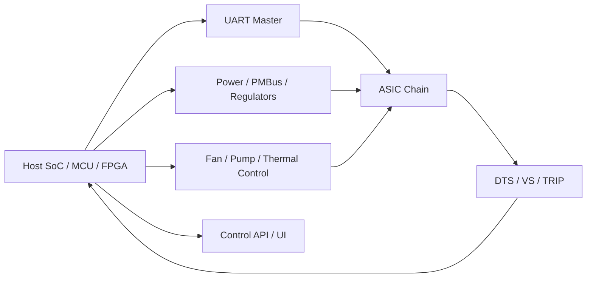
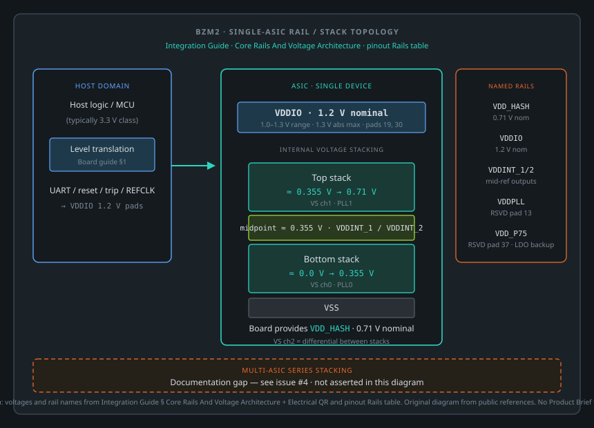
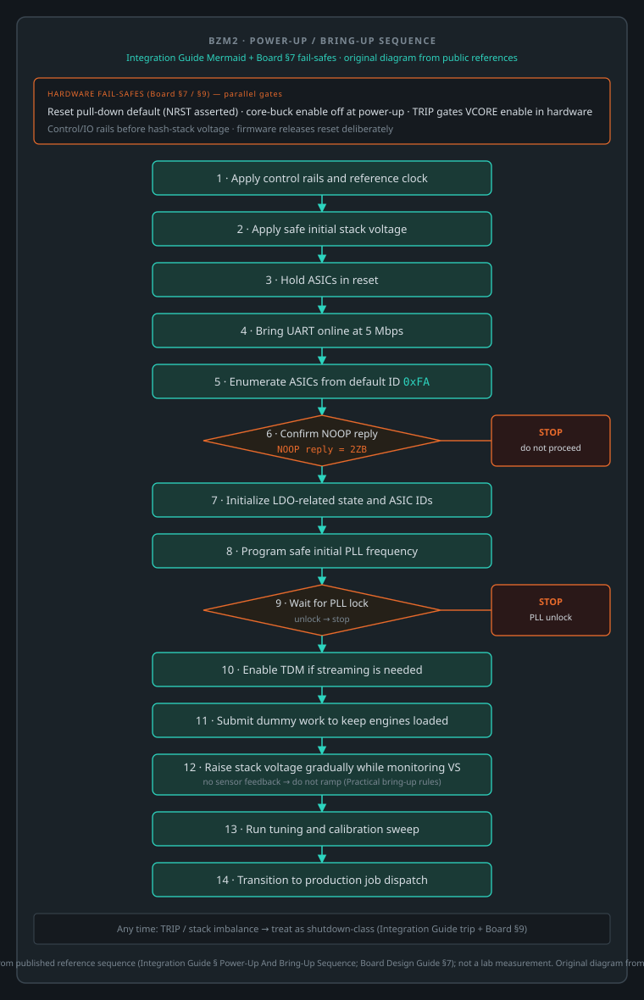
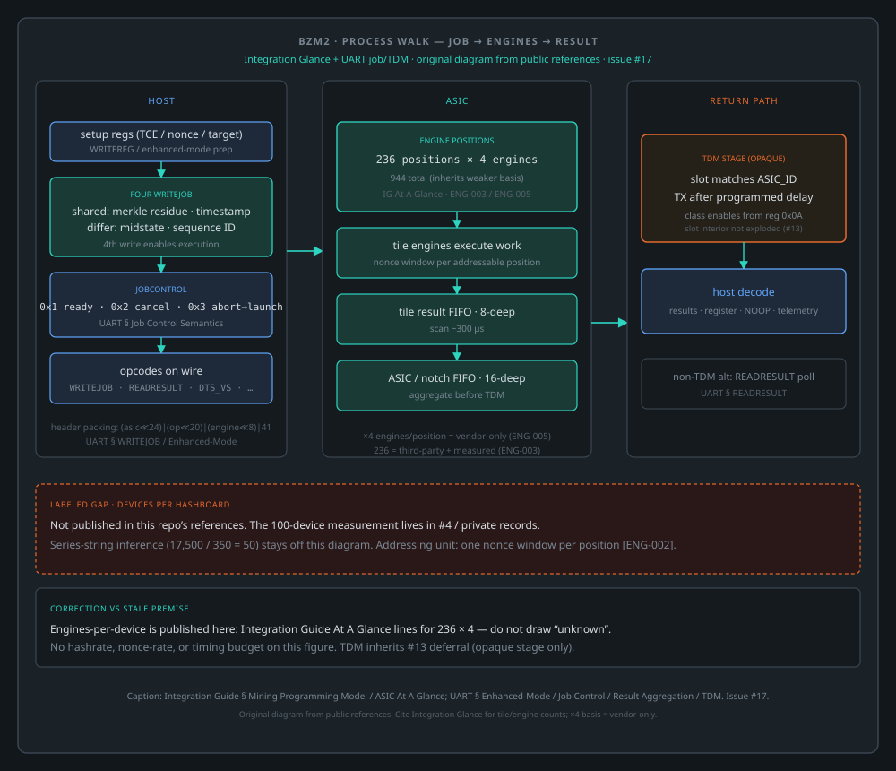

# Blockscale / BZM2 ASIC Hardware Integration Guide

## Purpose

This document consolidates ASIC-level behavior needed to design a custom
hardware solution around the Blockscale / BZM2 mining ASIC. It focuses on
generic implementation requirements:

- power architecture
- sequencing
- clocking
- UART transport
- multi-ASIC chaining
- telemetry
- protection
- tuning and calibration

It deliberately avoids copying vendor reference-board implementation details.
Those reference systems are useful examples, but they are not required for a
working design.

## Scope

This guide is for hardware developers building:

- a single-ASIC board
- a small multi-ASIC board with one or a few voltage domains
- a larger multi-ASIC platform with multiple voltage domains

The core constraint does not change with board size: every ASIC contains an
internal dual-stack engine arrangement and expects the host system to sequence,
clock, load, and protect it correctly.

## ASIC At A Glance

ASIC-level properties, with their bases separated because they differ:

- `236` addressable engine positions per ASIC `[BZM2-ENG-003]` - demonstrated by
  public open-source firmware and independently corroborated by our own capture
- `4` engines per position `[BZM2-ENG-005]` - **vendor material only**, no public
  or measured basis
- `944` total engines per ASIC - follows from the two above, so it inherits the
  weaker basis
- `2` primary PLL domains, corresponding to the bottom and top engine stacks
- on-die digital temperature sensing
- on-die three-channel voltage sensing
- UART as the primary host control and mining transport
- unicast, multicast, and broadcast job/register distribution
- TDM streaming for results, register responses, `NOOP`, and sensor data

Throughput per ASIC can be estimated as:

```text
Throughput (GH/s) = 236 * 4 * PLL_Frequency / 3 * Pass_Rate
```

Where:

- `PLL_Frequency` is in GHz
- `Pass_Rate` is `0.0` to `1.0`

Example:

```text
1.2 GHz * (236 * 4 / 3) * 1.0 = 377.6 gigahash per second
```

That formula is useful for sizing cooling, PSU headroom, calibration targets,
and per-domain operating points.

## Recommended System Partitioning

The ASIC does not require a specific vendor platform. It does require that the
overall system provide the following functions:

- stable control-side power
- stable stack-side power
- reference clock generation
- reset and trip handling
- UART master
- telemetry collection and protection logic
- work generation and result collection

**Arm the on-die protection before raising the stack, and confirm it took.**
Out of reset both sensors are powered down, so the trip output cannot assert at
any temperature or voltage. A stack ramp before arming runs with no on-die
protection at exactly the point where voltage and frequency are being raised.

The step does not need the stack: **VDDIO is a separate rail**, so an ASIC is
reachable over UART and its sensors are armable while the core stack does not
yet exist. This holds on any topology that follows the rail ordering above.

**Confirm from the device's own sensor stream, not by reading the registers
back.** A readback travels the same synchronous path that wrote them, so it
proves the path works rather than that the arming took. The part reports
`thermal_enabled` and `voltage_enabled` asynchronously and unprompted; that is a
witness. On a chain, record **which** device confirmed - a broadcast write is
acknowledged by the bus, not by every part on it.

**Anything that reads die temperature before this point gets no reading.** A
calibration or tuning pass that silently falls back to an ambient or board-level
proxy will choose operating points against the wrong temperature, and will do so
without erroring.



The exact split is your design choice:

- a Linux SoC can own all logic directly
- an MCU can own power sequencing while a host CPU owns mining
- an FPGA can assist with fanout, timing, or board aggregation

The ASIC-facing requirements remain the same.

## Package, IO, And Mechanical Constraints

Package and mechanical envelope:

- package size: `7.5 x 7 mm`
- package type: exposed-die molded `FCLGA`
- `60` SLI pads and `60` LGA pads
- operating junction temperature range: `50 C` to `85 C`
- absolute maximum junction temperature: `115 C`

Design implications:

- provide strong top-side thermal extraction
- assume continuous high leakage once stack voltage is present
- do not depend on reset state to keep thermal rise negligible
- plan for heatsink and forced airflow, or an equivalent thermal solution

Even a single-ASIC design should be treated as thermally active immediately
after hash rails are applied.

## Core Rails And Voltage Architecture

The ASIC is built around internal voltage stacking. The documents describe two
engine-stack ranges:

- bottom stack: approximately `0.0 V` to `0.355 V`
- top stack: approximately `0.355 V` to `0.71 V`

Additional named rails described in the vendor material:

- GPIO / control IO: `1.2 V`
- `VDD_HASH`: nominal `0.71 V`
- `VDD_P75`: backup rail if the on-chip LDO path is unavailable

### Rail / stack topology (single ASIC)



Original diagram from this section and the Electrical Quick Reference / pinout Rails table. Multi-ASIC series stacking is not drawn here: see [Voltage-Stack Topology Examples](bzm2-voltage-stack-examples.md) for the RDS (25 levels × 4 in parallel) and the published bitaxeBIRDS (4s1p) and bitaxeBonanza (4s2p) designs. No Product Brief tracing.

### Why voltage stacking matters

Voltage stacking is central to efficiency, but it also creates the main
hardware risk:

- the absolute stack voltages must stay inside safe limits
- the differential between the stacks must stay controlled
- bad sequencing or poor balancing can create overvoltage or thermal runaway

The ASIC includes internal voltage sensing specifically because the host must
monitor and react to stack imbalance.

### Voltage sensor channels

The internal voltage sensor reports three channels. Getting their scales wrong
produces bounds that cannot fire, so read the healthy-reading column before
setting any limit:

| channel | what it measures | healthy reading | can it trip the ASIC? |
| --- | --- | --- | --- |
| `ch0` | differential across the **bottom** stack | `~355 mV` | **yes** |
| `ch1` | differential across the **top** stack | `~355 mV` | **yes** |
| `ch2` | top-stack return against bottom-stack supply - the **midpoint error** | small, near zero at idle, grows with load | **no** |

Both stack channels read the differential across their **own** stack, not an
absolute node voltage, so both sit near `355 mV` and are directly comparable
to each other. Public reference firmware programs the
**same** shutdown code into both channels and bounds their difference with a
single spread limit - neither would be coherent if the two were on different
scales.

`ch2` is **not** a third rail and is **not** the `~355 mV` step between the
stacks. It is also **not** `ch1 − ch0`. It is the gap between the bottom
domain's top and the top domain's bottom: near zero on a healthy part at light
load, but it grows with load current (it behaves like a resistive drop across
the internal midpoint path). Bound it by **absolute magnitude** with a
**current-scaled** limit - a fixed near-zero alarm false-trips healthy parts at
full load - not by proximity to `355 mV`. The per-ASIC span is
`ch0 + ch2 + ch1`. `[BZM2-VS-001]`

**Only `ch0` and `ch1` feed the ASIC's own voltage shutdown.** The
voltage-sensor control register carries a threshold field for each of those
two and none for `ch2`, so the part takes no action on a midpoint fault. If
your design needs to survive one, the response has to be on the board or in
the host - nothing in the ASIC is watching.

Treat all three as first-class runtime safety inputs, not debug-only data -
but do not assume the part acts on all three.

## Electrical Quick Reference (Per ASIC)

Design-point numbers a board designer needs up front. The two operating points below are **publicly corroborated**: they match rows in
[bitaxeorg/bitaxeBIRDS `doc/specs.md`](https://github.com/bitaxeorg/bitaxeBIRDS/blob/main/doc/specs.md),
a published 25-point sweep on real hardware. Characterize on your own design
before committing limits.

| Parameter | Value | Notes |
| --- | --- | --- |
| `VDD_HASH` (stack rail) | `0.71 V` nominal | tunable window roughly `0.6` to `0.81 V` |
| Internal stack split | `0 - 0.355 V` / `0.355 - 0.71 V` | bottom / top engine stacks |
| Control / GPIO IO rail (`VDDIO`) | `1.2 V` nominal (`1.0 - 1.3 V` range), `1.3 V` abs max | UART, reset, trip signaling; per-pin input/output levels below |
| Stack current, stock operating point | `~14 A` | roughly `10 W` core power; a public sweep gives `13.6 A / 9.4 W` at `1.05 GHz` and `14.2 A / 9.9 W` at `1.10 GHz` |
| Stack current, maximum tuned point | `~27 A` | roughly `22 W`; plan copper for `~30 A` headroom. A public sweep's top row is `27.1 A / 21.95 W` at `0.810 V, 1.85 GHz` |
| Efficiency | best at a low clock, worsening as the clock rises | A public sweep puts the best efficiency near `0.60-0.75 GHz` and the worst at the maximum tuned point. Chasing best efficiency costs hashrate, and a single efficiency number is meaningless without the clock it was measured at |
| Reference clock | up to `50 MHz` on `REFCLKIN` | `50 MHz` is the standard choice |
| UART baud range | `2.5` to `10 Mbps` (50 MHz refclk) | bring-up convention is `5 Mbps` |
| Junction temperature | `50 - 85 C` operating, `115 C` abs max | plan top-side thermal extraction |

PDN guidance that follows directly from those numbers:

- the `VDD_HASH` path is a plane-and-via-farm problem, not a trace problem -
  budget wide pours and dozens of vias between layers, sized per IPC-2152
- decoupling must live close to the package; if a heatsink owns the top side,
  put the capacitor bank on the bottom side under the FCLGA land field
- at `0.71 V`, tens of millivolts of IR drop are several percent of the rail -
  measure remote-sense placement against your layout, not a reference design

### IO DC thresholds (the 1.2 V domain)

The control, UART, reset, trip, and reference-clock pads sit on the `VDDIO`
rail. Any signal driven into them must land inside the input window below;
exceeding the input-high limit overstresses the pad. Levels are given against
`VDDIO`, with the right column evaluated at the `1.2 V` nominal rail.
Synthesized from the vendor collateral - characterize before committing limits.

| Parameter | Spec | At `VDDIO = 1.2 V` |
| --- | --- | --- |
| `VDDIO` rail | `1.0` min / `1.2` nominal / `1.3 V` **abs max** | `1.2 V` |
| Input high `VIH` | min `0.65 x VDDIO`, **max `VDDIO + 0.3 V`** | `0.78 V` min, `1.5 V` max |
| Input low `VIL` | max `0.35 x VDDIO` | `0.42 V` max |
| Input threshold | `~0.6 V` | `0.6 V` |
| Output high `VOH` | min `0.75 x VDDIO` | `0.90 V` |
| Output low `VOL` | max `0.25 x VDDIO` | `0.30 V` |
| Peak overshoot (transient) | `VDDIO + 0.3 V` | `1.5 V` |
| Peak undershoot (transient) | `~0.3 V` below ground | `~ -0.3 V` |
| Pull-up / pull-down | `~20k` / `~24k` typical | strong pull-up `~3.4k` |

The absolute ceiling on any IO pin - static input-high or transient overshoot -
is **`VDDIO + 0.3 V`, i.e. `1.5 V`** at a `1.2 V` rail. Two direct consequences
for a board:

- **A `3.3 V` source cannot drive these pads through a simple resistive
  divider.** A `3.3 V` clock halved to `~1.65 V`, or a `3.3 V` UART through a
  `5.1k/3.3k` divider to `~1.3 V`, both sit at or above the input-high limit -
  overstress, not merely marginal. Use a real level translator, an
  AC-couple-and-bias network, or a `1.2 V`-domain source instead.
- **`REFCLKIN` specifically** wants a clean `1.2 V`-referenced swing (roughly
  ground to `VDDIO`), not a divided-down `3.3 V` oscillator - and watch source
  loading if you ever do use passive networks.

## Clocking

### External reference clock

The ASIC takes its reference clock on `REFCLKIN`:

- `REFCLKIN` is the ASIC reference clock input, specified up to `50 MHz`
- `50 MHz` is the standard choice - the UART baud range and the documented
  bring-up flow are both defined against a `50 MHz` reference

The ASIC also exposes `REFCLKOUT1` and `REFCLKOUT2`, primarily as
debug-oriented outputs.

### Internal PLLs

The ASIC uses two PLLs to feed the two internal engine stacks:

- `PLL0`: bottom stack
- `PLL1`: top stack

Bring-up implications:

- both PLLs are disabled by default
- software must enable them explicitly
- software must wait for lock before releasing dependent logic

When both divider classes are changed, the documented programming rule is:

1. write `FBDIV`
2. write `POSTDIV`

Do not reverse that order during live clock changes.

### Live clock changes on a hashing chain (measured)

What follows was measured on the RDS (unit `bonanza`, three boards of 100 ASICs) under the Mujina reference
firmware, in case MJ-TUNE-02, run `bonanza.MJ-TUNE-02.v17550b0.20261029T071354Z`. One chain had its ASICs' PLLs
moved one ASIC at a time, in ramped steps, while the other two chains hashed at fixed clocks. `[BZM2-PLL-001]`
`[BZM2-PLL-002]`

- **A live move of the feedback divider alone re-locks.** Every one of the 753 sets in that run read back locked.
  Die temperature on the chain stayed flat (mean about 56 C), so the effect below is not thermal.
- **One set costs the host about a second.** A separate run measured an upper bound of 1.06 s per set, including
  the caller's own cadence (MJ-TUNE-03, run `bonanza.MJ-TUNE-03.p1.20261029T043249Z`).
- **While sets run, the whole chain returns result frames with the nonce-valid status bit clear**, not only the ASIC
  being set. The reference firmware reads that bit as bit 3 (`0x08`) of the result status byte. In the run above
  the chain carrying the sets returned 38,000 to 130,000 such frames per 20 s poll for as long as the sets went on.
  The two chains with no sets returned about none. The frames stopped on every ASIC of the chain together, about
  40 s after the last set.
- **The host was starving the chain.** In that firmware each set was issued from the same single writer that sends
  work to the chain, so for the length of every set no ASIC on the chain received new work, and a round of 100 sets
  held the chain for most of ten minutes. The frames line up with that hold. Whether the ASIC clears the bit
  because its work ran out, or because of a PLL write elsewhere on the chain, is not separated by this run
  ([#40](https://github.com/Blockscale-Solutions/bzm2-hwref/issues/40)).
- **One unexplained burst.** The two chains with no sets showed one short burst of such frames, at about 915 s into
  the run, with no set running anywhere. Its trigger was not measured.

What a host should take from this:

- **A frame with the nonce-valid bit clear is not a result.** Count it on its own. Do not count it as a valid result
  or as a wrong one, and keep it out of any error ratio. Counted as wrong, it turned that run's start-frequency error
  figure into 72.7 %, when the chain's own steady-state wrong share with no sets running was 1.0 to 2.2 %.
- **Do not measure a chain while its clocks are being moved, or just after.** Mujina now discards any measurement
  interval that starts within a quiet period after the latest PLL set on the chain. It uses 45 s, which is that
  run's 40 s tail plus a margin, not a measured property of every board.
- **Do not block work dispatch for a run of PLL sets.** Each set holds whatever path it is issued from. If that is
  the chain's only dispatch path, the whole chain idles for the whole sequence.

Not yet established: whether these parts lock and run cleanly below 800 MHz in a hashing system
([#41](https://github.com/Blockscale-Solutions/bzm2-hwref/issues/41)).

### DLL health

The legacy software also validates DLL state using `coarsecon` and `fincon`
status. That is not strictly required to boot the ASIC, but it is useful for:

- manufacturing validation
- marginal-clock debug
- SI validation at new board layouts or cable lengths

If you are building a custom carrier or long-chain design, budget time for DLL
health checks during validation.

## UART And Chain Topology

UART is the primary host interface for:

- enumeration
- register control
- job dispatch
- result retrieval
- TDM streaming
- sensor retrieval

### Practical UART assumptions

- the link is **fixed 9-bit multidrop framing** - this is the single most
  important host-side constraint; see the physical-layer section of the
  [UART and TDM Reference](blockscale-uart-protocol-reference.md) for the
  framing details and host bridge selection guidance
- supported baud range is `2.5` to `10 Mbps` with a `50 MHz` reference clock;
  the documented bring-up convention is `5 Mbps`
- the internal `notch` controller block runs from the `50 MHz` clock during
  bring-up

The UART-related pads are `1.2 V` IO. Treat this as a real electrical
requirement when selecting the host UART PHY or level-shifting scheme.

### Chain orientation and pin muxing

The vendor material describes a `PINSEL`-based pin muxing arrangement where the
same physical pins can serve as:

- `RX_IN` / `TX_OUT`
- `RESET_IN` / `RESET_OUT`
- `TRIP_IN` / `TRIP_OUT`

This is what enables daisy-chain style system layouts. For a generic design,
the important point is:

- your schematic must preserve a consistent direction through the chain
- reset and trip propagation need the same level of attention as RX/TX routing

### ASIC enumeration model

The documented enumeration flow is:

1. all ASICs start with default `ASIC_ID = 0xFA`
2. the host addresses `0xFA`
3. the first visible ASIC responds
4. the host writes a unique `ASIC_ID`
5. writing the ID also unlocks `RX_OUT`
6. the next ASIC becomes reachable
7. repeat until the chain is assigned

`NOOP` returning `2ZB` is the simplest chain-liveness check. The bytes are the
part name reversed; comparing against `BZ2` matches nothing and reads as an
empty bus. See the protocol reference for the provenance of those three bytes —
they are attested by agreement among implementations, not yet by our own
measurement.

### Broadcast and multicast

The ASIC supports:

- unicast to one engine in one ASIC
- broadcast to the same engine position across all ASICs
- multicast to a row group

That capability is what makes large chains viable over UART. Use it for:

- initial register programming
- dummy-job deployment
- broad frequency ramps
- row-wise validation

Reserve unicast for:

- ASIC ID assignment
- per-ASIC final tuning
- fault isolation
- result ownership and targeted debug

## Power-Up And Bring-Up Sequence

The vendor documents describe a specific reference flow, but the reusable logic
for any custom board is:




Original flowchart (published source of truth): [power-up-sequence.svg](../drawings/bring-up/power-up-sequence.svg). Captures the Integration Guide bring-up sequence and Board Design Guide §7 / §9 fail-safes, including the post-#27 arm-protection gate with a **terminal STOP** if `thermal_enabled` / `voltage_enabled` are not confirmed before raising the stack. Caption: derived from published reference sequence; not a lab measurement. **NOOP reply:** `2ZB`, settled in #9. Editable Mermaid for redraws only: [power-up-sequence.mmd](../drawings/bring-up/power-up-sequence.mmd) — do not re-inline a second SoT here.

### Practical bring-up rules

- start from a conservative voltage
- start from a conservative clock, typically much lower than final operating
  point
- do not ramp voltage or frequency without sensor feedback
- do not leave engines idle during stack-balancing phases if your control
  strategy depends on balanced load
- do not start full production mining until IDs, PLL lock, and basic telemetry
  are confirmed

### Dummy-job use is not optional in stacked systems

The software guide and calibration material both treat dummy jobs as part of
power balancing, not merely a debug trick. In practice, dummy jobs help:

- keep engines drawing current
- maintain stack balance during ramp-up
- prevent some engines from sitting unloaded while others are active
- hold a repeatable thermal and electrical state during calibration

## Mining Programming Model



Original process diagram: host job programming → engines (236 positions × 4; Integration Glance) → result aggregation → **TDM as one opaque stage** (inherits #13 slot-interior deferral). Labeled gap: devices per hashboard. No hashrate / nonce-rate. Issue #17.


### Enhanced mode

Enhanced mode is the default engine programming mode. The documented sequence
for a valid four-lane engine-tile submission is:

1. enable TCE clocks
2. program nonce bounds and target
3. load the four midstates
4. program four write-job sequences
5. only the fourth write enables execution

The four logical writes share:

- merkle root residue
- start timestamp

They differ by:

- midstate
- sequence ID

### Job control behavior

The documented `JobControl` modes matter operationally:

- `0x1`: mark pending job ready
- `0x2`: cancel current and pending job, return to idle
- `0x3`: abort current job and immediately launch pending job

That cancel path is essential for recovery from invalid or stale engine state.

### Partial and invalid programming

The hardware documents are explicit about failure behavior:

- partial programming can consume bytes from a following write and create
  unintended nonces
- launching before the fourth write can cause incomplete jobs to execute
- disabled TCE lanes still require software to maintain correct sequencing
- unused TCE lanes should be flushed with zeroed dummy content

Do not assume the ASIC silently sanitizes malformed software behavior.

## Telemetry And Protection

### Temperature sensing

The ASIC exposes a digital temperature sensor. The developer guide and legacy
software both use the same conversion family:

```text
T = K + Y * (N - 2^11 / 2^R) / 2^12
```

Where:

- `T` = temperature in Celsius
- `N` = raw thermal tune code
- `R` = sensor resolution, typically `12`
- `Y = 631.8`
- `K = -293.8`

At default 12-bit resolution, a raw code near `2084` maps to approximately
`27.6 C`.

### Temperature thresholds

Three different temperatures appear in the vendor material and they are not the same quantity. Keep them apart.

1. **Junction temperature**, a datasheet figure: `0 - 85 C` operating range (typical `70 C`), `115 C` absolute maximum. The
   characterisation data adds that hash throughput falls off above `85 C` and recommends keeping the ASICs between `55`
   and `85 C`. This is a rating of the silicon, not a reading the software takes.
2. **The on-die sensor reading** (the thermal tune code above, converted to Celsius). This is what the host and the trip
   logic see. **No public or vendor source we hold gives the offset between the sensor reading and the junction
   temperature**, so a junction rating must not be applied to a sensor reading as if they were one number.
3. **The sensor trip level** a host programs into the ASIC (the trip described under Protection behavior).

The vendor software specification states staged thresholds on the sensor reading, per mining strategy:

| strategy | warning (event recorded per ASIC) | software shutdown (per ASIC, system shut down) | hardware thermal trip |
|---|---|---|---|
| balanced | `85 C` | `95 C` | `105 C` |
| high performance 1 | `90 C` | `100 C` | `110 C` |
| high performance 2 | `95 C` | `105 C` | `115 C` |

The same specification marks a working temperature of under `85 C` and says the thresholds were still to be settled. The
legacy daemon's own compiled defaults differ below the highest strategy: a warning at `105 C`, a software shutdown at
`110 C` (acted on only after the reading stays at or above it for more than ten consecutive polls) and a chip trip of
`115 C`, with the trip adjustable up to `125 C`. Both agree on `115 C` for the chip trip, and a capture of the stock
firmware at power-on shows it programming `115 C`. Which table a given daemon build applies is not settled by these
sources.

Observed on the stock firmware (RDS-PROF-01, high-performance-2 holds, for example run `r7-20261022T210432Z`): the hottest
board's hottest die printed `104 - 106 C` for about nineteen minutes without a shutdown, across four such holds of one hour.
No damage rating on the sensor reading exists in the material we hold.

Open gaps in this section, each with how to close it safely: the sensor-to-junction offset (#36), which threshold table the
stock daemon applies per strategy (#37), and damage or wear data on the sensor reading (#38).

### Voltage sensing

The voltage conversion used by the vendor guide and legacy implementation is:

```text
V = 1000 * (2 / 5) * VREF * (6 * N / 2^14 - 3 / 2^R - 1)
```

Where:

- `V` = uncalibrated voltage in mV
- `N` = raw sensor code
- `R` = voltage-sensor resolution
- `VREF = 0.7067`

### Protection behavior

**Out of reset, the ASIC is not protecting itself.** Both sensors come up
powered down, no thresholds exist, and **the trip output cannot assert at any
temperature or voltage** until a host programs the sensor block. A board with
the trip pin correctly wired to its core-rail enable has **no** overtemperature
protection until that programming happens - while appearing, on the schematic,
to have a hardware interlock.

Arming is therefore a mandatory bring-up stage, not an optimisation. Public
reference firmware treats it exactly that way: it writes the sensor enables,
both trip thresholds and the confirmation counts, verifies them by readback,
and **gates the clock stage on that verification** - refusing to proceed if the
sensors were not confirmed.

Once armed, the ASIC can assert a trip output when thermal or voltage
thresholds are exceeded. A robust system should wire this into board-level
protection.

Recommended policy:

- use sensor data for continuous host-side supervision
- use the trip path for fast hardware or firmware response
- treat temperature and differential stack voltage as shutdown-class signals
- never rely on software polling alone for destructive fault containment

## Calibration Methodology

The calibration material is useful as methodology, but not as a fixed set of
numbers. The reusable sequence is:

1. characterize a single ASIC or a small golden sample
2. choose conservative initial voltage and frequency
3. reset all ASICs to the safe starting point
4. bring stack voltage to a safe operating region
5. use dummy jobs to keep the electrical state stable
6. raise frequency in steps, commonly `25 MHz` coarse steps
7. measure pass rate, throughput, temperature, current, and power
8. raise voltage only if throughput targets cannot be met within thermal and
   power limits
9. once the board-level operating region is found, fine-tune individual ASICs
   in smaller steps, for example `6.25 MHz`
10. persist the resulting operating point for restart reuse

### Measured: the error ratio at a fixed start

The figures here were measured on the RDS (unit `bonanza`) under the Mujina reference firmware, case MJ-TUNE-02. In
each run every ASIC of one board started at a uniform `800 MHz`, with the shared supply set to `17,550 mV` (the three
board rails read `17.46 - 17.83 V`). The **error ratio** is wrong results over valid plus wrong, where a wrong result
is a nonce that does not meet the target. Frames with the nonce-valid bit clear are counted apart and left out (see
[Live clock changes on a hashing chain](#live-clock-changes-on-a-hashing-chain-measured)). Each ASIC's figure is its
first dwell at the start. `[BZM2-CAL-001]` `[BZM2-CAL-002]` `[BZM2-CAL-003]`

| run | board | board ratio (all ASICs pooled) | median ASIC | dispersion (chi-squared per degree of freedom) | board ratio without its high-error tail |
|---|---|---|---|---|---|
| `bonanza.MJ-TUNE-02.v17550b0.20261029T135804Z` | 0 | 1.0748 % | 0.5939 % | 11.13 | 0.6548 % |
| `bonanza.MJ-TUNE-02.v17550b1.20261029T172540Z` | 1 | 0.5168 % | 0.2642 % | 7.92 | 0.3817 % |
| `bonanza.MJ-TUNE-02.v17550b2.20261030T011051Z` | 2 | 1.1049 % | 0.6614 % | 11.08 | 0.7717 % |

What the table and its reruns show:

- **ASICs on one board do not share one error rate.** A dispersion of 8 to 11 is far above the 1 that a common rate
  would give. The median ASIC on every board is under 0.7 %, while the worst ASICs read 4 to 7 % at the same clock:
  on board 0, ASIC 20 read 6.60 % and ASIC 98 read 5.28 %; on board 2, ASIC 87 read 6.96 % and ASIC 43 read 6.04 %.
- **A board's pooled figure is carried by its tail.** A handful of high-error ASICs set the board number, so a board
  pass or fail at one clock is mostly a statement about those few ASICs.
- **Boards differ even without the tail.** With the high-error ASICs taken out, the boards still read 0.38, 0.65 and
  0.77 %. That is silicon variation between boards, at an identical start.
- **Runs differ.** The same board at the same start gave about twice the figure on a later run: board 1 read 0.5168 %
  and then 1.038 % (`bonanza.MJ-TUNE-02.v17550b1.20261030T035225Z`), and board 0 read 1.075 % and then 1.985 %
  (`bonanza.MJ-TUNE-02.v17550b0.20261030T021147Z`). A single reading at a fixed threshold is not a property of the
  board.
- **A threshold taken from one board of one run does not transfer.** A start ceiling derived from one board's
  earlier figure failed two of these three boards.
- **The stock firmware starts the same way.** Our capture of it (RDS-CAL-03, run `20261009T174718Z`) enables every
  PLL at `800 MHz`, measures each board at that uniform point, and then moves the whole board up. All three boards
  went on from that point, at figures the stock firmware printed as 0.24 to 0.35 %. The two firmwares' ratios are not
  directly comparable: at the same board and start, the reference firmware's figure ran 2.15 to 3.25 times the stock
  print, and board 1 was the lowest in both
  ([#43](https://github.com/Blockscale-Solutions/bzm2-hwref/issues/43)).

What to take from this for a calibration design:

- Make the **ASIC** the unit that a start-frequency decision acts on. Keep the board's pooled figure as a record and a
  reference for that board, not as a gate.
- Expect a tail. A few ASICs per board will sit well above the rest. Park them low and keep them hashing rather than
  failing the board.
- Derive thresholds from several boards and several runs, and record which ones.
- Whether a high-error ASIC improves at a lower clock is not yet known
  ([#41](https://github.com/Blockscale-Solutions/bzm2-hwref/issues/41)).

### Calibration inputs that should be board-specific

The following should be measured on your own design, not copied from a vendor
reference system:

- PSU current limits
- PSU power limits
- board thermal limits
- acceptable stack imbalance
- safe junction temperature target
- fan or pump response curves
- pass-rate thresholds for field use

### What scales from 1 ASIC to 100 ASICs

A practical strategy for scale is:

- characterize at the domain level first
- then fine-tune per ASIC

For example:

- `1 ASIC`: one domain, direct per-ASIC tuning
- `4 ASICs`: tune the shared rail first, then trim per ASIC if needed
- `100 ASICs`: first establish safe per-domain voltage and coarse clock, then
  apply per-ASIC final offsets

That is also the model implemented in the Rust tuning planner in this
repository.

## Design Recommendations By System Size

### Single-ASIC board

Recommended priorities:

- keep power sequencing simple and deterministic
- expose UART, reset, and trip for debug access
- expose DTS/VS in firmware or API from day one
- use direct per-ASIC characterization rather than heavy-weight broadcast flows

### Small multi-ASIC board

Recommended priorities:

- decide early whether all ASICs truly share one rail policy
- keep chain routing short and deterministic
- implement broadcast writes and per-ASIC unicast verification
- maintain enough sensor visibility to identify one bad ASIC quickly

### Large multi-domain system

Recommended priorities:

- treat domain balancing as a system function, not an afterthought
- separate board protection from mining software
- use broadcast for coarse actions and unicast for final trim
- persist calibration state and replay it on restart
- provide out-of-band observability for voltage, current, and trip events

## Common Failure Modes

Expect these classes of issues during bring-up:

- chain breaks due to mux orientation or RX/TX direction errors
- false confidence from UART liveness before IDs or PLLs are fully initialized
- stack imbalance during idle or partial-load operation
- thermal runaway from insufficient cooling during early ramp
- residual engine programming causing unexpected nonces
- malformed partial write-job sequences
- assuming all engine IDs are contiguous or present

Design for fast isolation:

- per-domain current and voltage visibility
- easy reset control
- easy UART capture
- per-ASIC NOOP and register-read debug
- trip logging

## Minimum Validation Checklist

Before calling a hardware platform ready, verify:

- control IO is truly `1.2 V` compatible
- reference clock integrity at the ASIC pin
- reset propagation through the entire chain
- per-ASIC enumeration from default ID
- `NOOP` response integrity across the full chain
- stable PLL lock across the intended operating range
- valid DTS/VS readings for every ASIC
- no dangerous stack imbalance at idle, dummy load, and production load
- sustained production pass rate at target operating point
- protection response for overtemperature and stack-voltage faults

## Relationship To The Mujina Reference Firmware

The **Mujina** miner project carries a practical Rust implementation of the
core ASIC behavior discussed above:

- UART opcode support
- TDM parsing
- PLL and DLL diagnostics
- DTS/VS telemetry
- on-demand sensor query support
- startup tuning and saved operating-point replay
- silicon-validation CLI flows

Relevant follow-on documents:

- [UART and TDM Reference](blockscale-uart-protocol-reference.md) - the
  protocol companion to this guide
- [BZM2 Port Note](bzm2-port.md), [BZM2 UART Debug Guide](bzm2-uart-debug.md),
  [BZM2 Tuning Planner Note](bzm2-pnp.md) - Mujina port engineering notes
  (firmware-side history, slated to move to the firmware repository)
