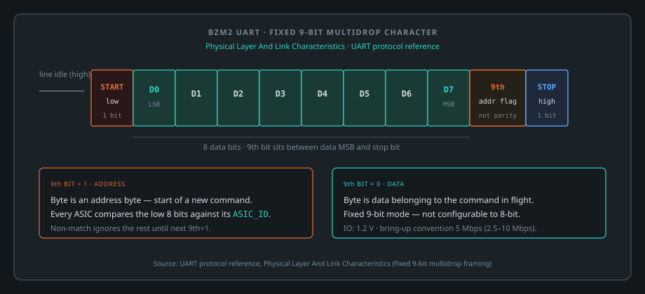
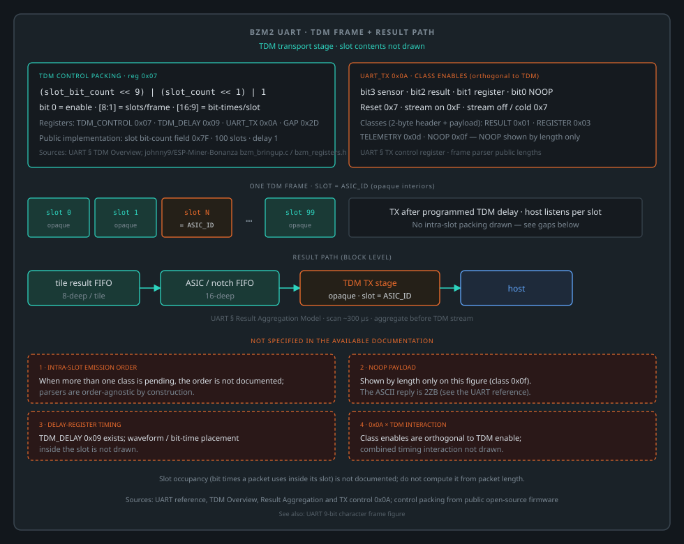

# Blockscale / BZM2 UART And TDM Protocol Reference

## Purpose

This document summarizes the ASIC-facing UART protocol, TDM behavior, and job
programming model needed to write host software or validation tooling for the
Blockscale / BZM2 ASIC family.

It is written as a practical reference for:

- firmware developers
- board bring-up engineers
- validation engineers
- host software developers

Terms and abbreviations (TCE, notch, DTS/VS, TDM, enhanced mode) are defined in the Integration Guide under
[Terms Used In This Reference](blockscale-asic-integration-guide.md#terms-used-in-this-reference).

## Physical Layer And Link Characteristics

### Fixed 9-bit multidrop framing




One character on the wire: start bit, data bits D0–D7, the 9th address flag, then stop. The TDM frame and result path are drawn under TDM Overview.

This is the most important host-side fact about the link, and the one that
disqualifies most off-the-shelf USB-UART bridges:

- the UART operates in a **fixed 9-bit mode** - it is not configurable down to
  standard 8-bit framing
- each character carries `8` data bits plus a 9th bit between the data MSB and
  the stop bit
- the 9th bit is an **address flag** implementing single-master / multi-slave
  (multidrop) operation:
  - 9th bit = `1`: this byte is an address byte - the start of a new command;
    every ASIC compares the low 8 bits against its own `ASIC_ID`
  - 9th bit = `0`: this byte is data belonging to the command in flight
- an ASIC that does not match the address byte ignores the rest of the command
  and waits for the next byte with the 9th bit set

### Baud and signaling

- supported baud range: `2.5` to `10 Mbps` with a `50 MHz` reference clock
- the documented bring-up convention (and the rate the stock firmware uses)
  is `5 Mbps`
- `1.2 V` IO signaling on the UART-related pads - level shifting is required
  against almost any host

Practical recommendation:

- establish communication at `5 Mbps` first
- validate signal integrity there before attempting any custom timing changes

### Host bridge selection

The combination of `5 Mbps` and true 9-bit framing rules out most common
USB-UART bridges. A host needs either a bridge with a native 9-bit (multidrop)
mode at `5 Mbps` or above, or an MCU or SoC UART (or PIO) that does 9-bit
framing in hardware. Emulating the 9th bit by flipping MARK/SPACE parity on an
8-bit UART does not keep up at these rates: the parity setting has to change
per byte.

Specific bridges and MCUs, with their published rate limits and the open boards
that use them, are compared in the
[Reference Design Guidance, 9-bit UART host bridge](bzm2-reference-design-guidance.md#12-9-bit-uart-host-bridge).

## Addressing Model

Each command carries:

- `ASIC_ID`
- opcode
- engine or group identifier
- register offset or data payload, depending on opcode

The documented system addressing model allocates:

- normal engine space for engine tiles
- top `0xFxx` engine-ID region for non-engine / local functions such as PLLs,
  sensors, and internal controller blocks

Do not assume engine IDs are contiguous or fully populated. Vendor-stated: the
map can have holes where engines are disabled or missing.

### Engine identifier layout

The engine identifier is a 12-bit row/column pair. The row occupies the low six
bits and the column sits above it: `engine_id = (col << 6) | row`. `[BZM2-ENG-001]`

A device carries **236 addressable engine positions**. `[BZM2-ENG-003]` Each
position contains **4 engines**, for **944 engines per ASIC**. `[BZM2-ENG-005]`

The two figures rest on different evidence: **236** is used by public
open-source firmware and corroborated by bench capture; the **x4** is
vendor-stated. The throughput estimate that uses the same figures is in the
Integration Guide, [ASIC At A Glance](blockscale-asic-integration-guide.md#asic-at-a-glance).

The distinction matters whenever a number is used as a denominator:

| you are dividing by | use | because |
| --- | --- | --- |
| addressable positions (nonce windows, register writes, dispatch entries) | **236** | a register write addresses a tile |
| hashing capacity (hash rate, J/TH, pass rate) | **944** | each tile contains four engines |

Using one figure for both is a silent factor-of-four error. Nothing in the
protocol reports it, and both numbers appear in vendor material without the unit
being named.

### Engine grid: rows, columns and stacks

`[BZM2-ENG-007]`

The two fields of the engine identifier name a position on a grid of **20 rows by 12 columns**: `row` runs `0` to
`19` and `col` runs `0` to `11`. A **row** is one value of the identifier's low six bits; the twelve positions that
share it differ only in column. Each grid position is one engine position (tile), the unit a register write, a nonce
window or a dispatch entry addresses.

The grid has 240 coordinates and **four of them are not populated**: (row `0`, col `4`), (row `0`, col `5`),
(row `19`, col `5`) and (row `19`, col `11`). The other 236 are the addressable engine positions. Skip the four holes
when building a dispatch table; do not count them in a denominator.

Rows divide the positions between the two engine stacks:

| rows | stack | populated positions | engines (at 4 per position) |
| --- | --- | --- | --- |
| `0` - `9` | bottom | 118 (120 less the two holes in row `0`) | 472 |
| `10` - `19` | top | 118 (120 less the two holes in row `19`) | 472 |

The two stacks carry the same number of positions. The engine count per stack follows from the four engines per
position, which is vendor-stated `[BZM2-ENG-005]`.

On an RDS, result frames captured under the stock firmware came from exactly these 236 positions, and from none of
the four holes or any coordinate outside the grid; see
[Engine grid and IDs on a stock chain](rds-measured-reference.md#engine-grid-and-ids-on-a-stock-chain).

Not established: where rows and columns sit physically on the die, which PLL index clocks which stack, and how the
row group that `MULTICAST_WRITE` addresses relates to a grid row.

## ASIC Identification

Relevant ID values used during system bring-up:

- `0xFA`: default ID before enumeration
- `0xFF`: platform-wide broadcast ID

Enumeration rule:

- writing a unique `ASIC_ID` to an ASIC previously addressed at `0xFA` also
  unlocks forwarding so the next ASIC becomes reachable

### A single device and the default ID

`[BZM2-UART-004]` `[BZM2-UART-005]`

**Assign an ID on a one-device board, exactly as on a chain.** Whether a device may run indefinitely at `0xFA` is not
established: no public implementation leaves a device at the default ID once discovery has run, and no measurement of a
device left there has been published. Assigning costs one register write and a readback.

Public open-source firmware for this part assigns every device an ID below `0xFA` and confirms it by reading the
`ASIC_ID` register back at the new ID. Once its devices are numbered it requires a `NOOP` to `0xFA` to draw no reply,
so that a device left unnumbered is caught as a fault. Under the RDS stock
firmware, a 100-device chain answers under IDs `0x00` to `0x63`; see
[Engine grid and IDs on a stock chain](rds-measured-reference.md#engine-grid-and-ids-on-a-stock-chain).

Two consequences of staying at the default, inferred from the published addressing and TDM rules:

- **Discovery cannot tell it apart from an unassigned device.** `0xFA` addresses whichever device has not yet been
  given an ID. A device left there answers every discovery probe, so a host cannot confirm the chain has ended, and
  any later discovery pass takes it as a new device.
- **It owns TDM slot `250`.** A device transmits in the slot that matches its ID ([TDM Overview](#tdm-overview)), so a
  device at `0xFA` is heard only if the TDM frame has more than 250 slots. A device at `0x00` needs one. Whether the
  part accepts a frame that long is not established.

Choose any ID below `0xFA`; never `0xFF`, which is the broadcast ID. A low ID keeps the TDM frame short.

## Routing Modes

### Unicast

Use unicast when you need:

- one register or job to one engine in one ASIC
- per-ASIC tuning
- precise debug
- result ownership validation

### Broadcast

Use broadcast when you need:

- the same action on the same target across all ASICs
- coarse startup programming
- coarse frequency ramps
- fast deployment of common work or dummy work

#### A broadcast read is answered by every device, under its own ID

`[BZM2-UART-001]`

`0xFF` addresses the request; it does not appear in any reply. A broadcast register read is answered by the devices on
the chain one by one, and each answer carries that device's own `ASIC_ID` in the ID field, not `0xFF`. On a 100-device
RDS chain, one broadcast register read drew 99 replies in the capture, each under a distinct ID and none under `0xFF`
(MJ-OBS-01, run `20260921T144604Z`).

The opposite assumption fails silently. A host that broadcasts a read and waits for a reply whose ID equals `0xFF`
times out while the chain is answering correctly, with no error and no malformed frame to show the request was wrong.
Because the ID that arrives first varies with timing, the failure can look like line noise. For a host:

- match a broadcast reply on any responder ID (the opcode still has to match), not on the broadcast ID
- expect up to N replies to one broadcast read on an N-device chain, and drain them before the next request, or they
  arrive as unsolicited traffic inside the next transaction

### Multicast

Use multicast when you need:

- row-wise engine programming
- efficient fanout inside one ASIC or across ASICs
- validation flows that target equivalent engine positions

The vendor material treats multicast write as a row-group fanout mechanism and
also uses it as the basis for some broadcast-style write patterns.

## Opcode Summary

| Opcode | Name | Primary use | Typical response |
| --- | --- | --- | --- |
| `0x0` | `WRITEJOB` | Write engine job state and launch work | No immediate payload response |
| `0x1` | `READRESULT` | Poll ASIC result buffer in non-TDM mode | Result record with status |
| `0x2` | `WRITEREG` | Write engine or local registers | No immediate payload response |
| `0x3` | `READREG` | Read engine or local registers | Register data |
| `0x4` | `MULTICAST_WRITE` | Write a row-group of engines | No immediate payload response |
| `0x5` | `BLOCK_HDR` | Named in vendor material. **Not emitted or recognised by any public implementation** - see below. | Unknown |
| `0xD` | `DTS_VS` | Read thermal and voltage sensor data | Sensor payload |
| `0xE` | `LOOPBACK` | Echo payload for transport validation | Echoed payload |
| `0xF` | `NOOP` | Link and chain liveness test | ASCII `2ZB` |

### Opcode `0x5`, and the gap above it

`0x5` is attested in vendor material as `BLOCK_HDR`. **Its direction, payload
length and layout, response behaviour, host-side trigger and broadcast
addressability are all unknown to this reference**, and no public source
carries any of them.

What *can* be said, and is worth saying, is the negative - because it bounds
what an implementer actually needs.

#### `0x5` is not needed to mine this part

[`johnny9/ESP-Miner-Bonanza`](https://github.com/johnny9/ESP-Miner-Bonanza)
(GPL-3.0) is an independent open-source implementation that drives this ASIC.
Its **entire** command surface is three transmit encoders and four receive
frame types:

| direction | encoders and frame types |
| --- | --- |
| transmit | `bzm_transport_encode_write` (`0x2`), `bzm_transport_encode_read` (`0x3`), `bzm_transport_encode_noop` (`0xF`) - declared at `components/asic/include/bzm_transport.h:98-102`, opcode nibbles visible as `0x020` / `0x030` / `0x0f0` at `components/asic/bzm_transport.c:164`, `:187`, `:202` |
| receive | `RESULT 0x01`, `REGISTER 0x03`, `TELEMETRY 0x0d`, `NOOP 0x0f` - `components/asic/include/bzm_frame_parser.h:20-23` |

There is no `0x5` encoder and no job-submission opcode at all: **work is
programmed through register writes.** That firmware is hardware-qualified -
`components/asic/include/bzm.h:18-20` records seven independent results
reproduced on a Bitaxe 1002. So mining is demonstrably possible without ever
issuing or handling `0x5`.

#### But an unhandled `0x5` is still a data-loss bug

This is the concrete reason the row exists, and it is citable rather than
asserted. That same parser treats an unrecognised opcode as a desynchronised
stream: `components/asic/bzm_frame_parser.c:97` returns `0` from the `default:`
arm, leaving the header invalid, and the caller then discards **one byte** and
resynchronises (`:111-113`, again at `:152-154`).

One byte at a time means the parser walks *into* the frame body and through
whatever follows it. A `0x5` frame arriving at a receiver that does not know
its length therefore costs the frames **around** it, not just itself. The
failure presents as intermittent corruption with no pointer back to the cause.

**An implementer should decide deliberately what to do with an opcode outside
the known set** - resynchronise, hard-error, or log - rather than inherit
byte-at-a-time discard by default.

#### Opcodes `0x6` through `0xC` are unmapped

Not "unused": nothing is documented about them. Treat the known set as a
**lower bound** on what the part may emit.

#### Where `0x5` is documented

The semantics of `0x5` are not public. A capture from a public host cannot
reveal them either: no public implementation emits `0x5`.

## Frame Structure

### Two host-side encodings of one wire format

On the wire every character is one 9-bit UART character (figure above). Hosts
hand those characters to the link in one of two forms, and byte counts quoted
for a command depend on which one is meant:

- **Raw 9-bit word stream**, for a host that drives the 9-bit characters itself
  (a bridge in 9-bit mode, an MCU UART or PIO). Each character is a 9-bit word,
  carried in the host's byte stream as **two bytes**: the low eight bits first,
  then the ninth bit on its own. The frames under *Command frames* below are in
  this form.
- **Length-prefixed packet**, for a host that writes through a 9-bit tty driver
  (as on the RDS). Each command is one packet: a 2-byte little-endian total
  length that counts itself, a big-endian header, then the payload. The driver
  sends the header's first byte, the ASIC ID, as the address character
  (inferred: it is the only byte that can match). The packet sizes are listed
  under [Length-prefixed packet sizes](#length-prefixed-packet-sizes).

### The 9-bit word

**Bit 8 is the address flag.** It is set on the first word of a frame and clear
on every word after it. That is the whole multidrop mechanism - a part watches
for a character with bit 8 set, compares the low byte against its own ASIC ID,
and either claims the frame or ignores everything until the next address
character.

**A frame therefore opens with the address character, not with a length.** A
transmitter that puts a length byte first lands the address flag on the wrong
character, no part matches, and the command is discarded silently - which on the
wire is indistinguishable from an absent chain. The length prefix of the
packet form is for the driver; on the wire the address character still comes
first.

### Command frames

Raw word-stream form. Words below are 9-bit; each costs two bytes in the host's
stream.

```text
NOOP                                  2 words
  0x100 | asic_id                     address character
  0x0F0                               opcode nibble 0xF

WRITEREG                              5 words + data + 1
  0x100 | asic_id                     address character
  0x020 | ((engine_id >> 8) & 0x0F)   opcode nibble 0x2, engine_id[11:8]
  engine_id & 0xFF                    engine_id[7:0]
  offset                              register offset
  data_len - 1                        length MINUS ONE
  data[0..n]                          payload, one word per byte
  0x000                               trailing word

READREG                               6 words
  0x100 | asic_id                     address character
  0x030 | ((engine_id >> 8) & 0x0F)   opcode nibble 0x3, engine_id[11:8]
  engine_id & 0xFF                    engine_id[7:0]
  offset                              register offset
  data_len - 1                        length MINUS ONE
  0x000                               trailing word
```

Two details that are easy to get wrong: the length field carries **length minus
one**, and `NOOP` is **two words**, not the five-word shape the register frames
use. Deriving a `NOOP` from a `WRITEREG` produces a frame the part will not
answer.

### Length-prefixed packet sizes

The same commands in the packet form a 9-bit tty driver takes. Register and job
commands carry a 32-bit header,
`(asic_id << 24) | (opcode << 20) | (engine_id << 8) | offset`; `NOOP`,
`READRESULT` and `LOOPBACK` carry a 16-bit header,
`(asic_id << 8) | (opcode << 4)`.

| command | packet bytes | layout after the 2-byte length |
| --- | --- | --- |
| `WRITEREG`, `MULTICAST_WRITE` | `7 + count` | 4-byte header, `count - 1`, `count` data bytes |
| `READREG` | `8` | 4-byte header, `count - 1`, one trailing byte |
| `WRITEJOB` | `48` | 4-byte header whose low byte is `41` (42 job bytes, minus one), 32-byte midstate, 4-byte merkle residue, 4-byte timestamp, sequence ID, job control |
| `READRESULT`, `NOOP` | `4` | 2-byte header |
| `LOOPBACK` | `5 + count` | 2-byte header, `count - 1`, `count` data bytes |

Basis: the encoders of the Mujina BZM2 reference fork,
[`mujina-miner/src/asic/bzm2/protocol.rs`](https://github.com/recklessnode/mujinabzm2/blob/c7f8e03a4006356e090e184a2fa73a057df73a80/mujina-miner/src/asic/bzm2/protocol.rs#L477-L568)
at `c7f8e03`, which drive the RDS chain ports.

### Reaching the ASIC's own registers

The engine field addresses an engine position. To reach the **ASIC's own local
registers** instead - the TX control register below, the sensor block, the TDM
configuration - put **`0xFFF`** in the engine field. It is not an engine; it is
the control path.

Every instruction in this document that touches a local register goes through
that value. Local register payloads are **32-bit little-endian**; reading one in
the wrong byte order returns a plausible wrong number rather than an error.

### Responses are not self-delimiting

**This is the single most important thing about receiving from this part.** A
response carries a two-byte header and a payload whose length is implied by the
frame type. There is **no length field and no delimiter** anywhere in it.

```text
byte 0   ASIC ID
byte 1   frame type
byte 2.. payload, length implied by type

  0x01  RESULT      8 bytes   (10 when TDM-wrapped)
  0x03  REGISTER    length the host asked for - NOT on the wire
  0x0D  TELEMETRY   8 bytes
  0x0F  NOOP        3 bytes
```

A receiver's only synchronisation is a **static type-to-length table**. That has
three consequences worth stating plainly:

- **A register response carries no length.** The host must remember what it
  asked for, which means one outstanding read per ASIC.
- **An unrecognised type costs more than its own frame.** With no delimiter to
  resynchronise on, a receiver can only discard a byte and retry, walking
  forward through the frame body and into whatever follows. That is why an
  unhandled opcode shows up as intermittent corruption elsewhere rather than as
  an error at the offending frame.
- **Guessing the payload generation mis-frames the stream.** A four-byte sensor
  payload read as eight consumes the frames after it.

### `NOOP`

Purpose:

- confirm the ASIC is synchronized with the host
- confirm chain reachability

Behavior:

- transmit a short command to a specific ASIC
- receive three ASCII bytes: `2ZB`

The bytes are the part name **reversed**, and that is worth stating plainly
because the obvious spelling is the wrong one. An implementer who compares the
reply against `BZ2` gets no match, concludes there is no device at that
address, and stops the chain walk at zero — which is indistinguishable from an
empty bus. Nothing about the failure points at the comparison.

Both spellings occur in software for this part, for different purposes: one
is the part identifier, the other is this reply. Check which one you are
comparing against.

> **Basis.** `2ZB` is what three independent implementations compare
> against: two reference implementations and one third-party firmware port.
> This is agreement among sources rather than a bench measurement, and the
> sources are not fully independent of each other (the third-party port may
> have read the same headers), so treat the reply as well-attested rather than
> confirmed.
>
> One of those sources is public and can be named:
> [`johnny9/ESP-Miner-Bonanza`](https://github.com/johnny9/ESP-Miner-Bonanza)
> (GPL-3.0) compares the NOOP payload against the literal `"2ZB"` at
> `components/asic/bzm_transport.c:66` and counts a mismatch as an invalid
> frame. That is a working implementation rejecting `BZ2`, not a document
> repeating it.

Practical use:

- first link test after setting baud
- chain walk after programming IDs
- low-risk sanity check during debug

### `WRITEJOB`

Purpose:

- deliver engine work over UART

Documented behavior:

- writes `42` consecutive bytes of job state
- in the length-prefixed packet form the command is `48` bytes (see
  [Length-prefixed packet sizes](#length-prefixed-packet-sizes))

Payload content includes:

- `32` bytes of midstate
- merkle root residue
- start timestamp
- sequence ID
- job control

Header in the length-prefixed packet form:

```text
header = (asic << 24) | (WRITEJOB << 20) | (engine << 8) | 41
```

`WRITEJOB` is not needed to mine the part: the public implementation described
under opcode `0x5` programs work through register writes only.

### `READRESULT`

Purpose:

- poll the ASIC-level result buffer directly in non-TDM mode

Returned fields include:

- status
- engine ID
- sequence ID
- nonce
- timestamp

A clear valid bit is not the same as a framing error. The host is expected to
consume the full response length even when no valid result is present.

The same holds for result frames in the TDM stream: a frame whose nonce-valid status bit is clear is not a
result, valid or wrong, and belongs in its own count. A chain can return such frames in large numbers while its
clocks are being changed; see the Integration Guide,
[Live clock changes on a hashing chain](blockscale-asic-integration-guide.md#live-clock-changes-on-a-hashing-chain).

### `WRITEREG`

Purpose:

- write a target register range

Documented behavior:

- the payload carries a byte count encoded as `count - 1`
- the command is `6 + count` words in the raw word stream (see *Command frames*)
  and `7 + count` bytes as a length-prefixed packet

Common uses:

- enabling clocks
- programming nonce bounds and target
- local-register setup for TDM, clocking, or sensors

### `READREG`

Purpose:

- read a target register range

Practical uses:

- register validation during bring-up
- ASIC-local debug
- clock and sensor status inspection

### `MULTICAST_WRITE`

Purpose:

- write one register range to multiple engines identified by a row-group ID

Common uses:

- row-wise initialization
- engine-wide or board-wide debug patterns
- efficient deployment of common register state

### `LOOPBACK`

Purpose:

- validate the link by echoing a chosen payload

Use cases:

- transport validation before full job submission
- characterization of chain reliability at length
- regression tests after changing clocks, cabling, or PHY conditions

### `DTS_VS`

Purpose:

- retrieve thermal and voltage-sensor data

It can be used:

- directly as a query
- indirectly through TDM streaming when enabled

## Enhanced-Mode Job Programming

Enhanced mode is the normal software contract for engine operation.

Required setup before job submission:

- enable TCE clocks via config register `0x01`
- program `StartNonce` at `0x3C`
- program `EndNonce` at `0x40`
- program `Target` at `0x44`
- load the four midstates beginning at `0x10`

`StartNonce` and `EndNonce` are written against the **addressable engine id** -
the same 12-bit id as every other work register - and no finer unit appears
anywhere in the write path. `[BZM2-ENG-002]` A partition therefore divides the
nonce space by **236**, while a hash-rate denominator counts engines (944).
Getting that backwards is a silent 4x error.

Stated precisely, because the distinction matters: the register map **exposes**
one window per position. That is not the same as proving the four engines at a
position cannot be windowed by some undocumented means, and this reference does
not claim the stronger thing.

Both endpoints must be even. `[BZM2-ENG-004]`

### Four-write sequence

| Write | `0x30` MR residue | `0x34` start timestamp | `0x38` sequence ID | `0x39` job control |
| --- | --- | --- | --- | --- |
| `WriteJob_0` | same value | same value | `0b00` | `0x0` |
| `WriteJob_1` | same value | same value | `0b01` | `0x0` |
| `WriteJob_2` | same value | same value | `0b10` | `0x0` |
| `WriteJob_3` | same value | same value | `0b11` | `0x1` or `0x3` |

Key rule:

- only the fourth write should launch execution

If `JobControl` is asserted too early, the job can be launched in an incomplete
state.

### From a pool job to the four writes

The four writes carry one Stratum v1 job, split along the SHA-256 block
boundary of the 80-byte block header. The header is version (4 bytes),
previous-block hash (32), merkle root (32), ntime (4), nBits (4) and nonce (4).
SHA-256 consumes it in 64-byte blocks, so the first block holds the version, the
previous-block hash and the first 28 bytes of the merkle root, and the second
block holds the merkle root's last 4 bytes, ntime, nBits and the nonce.
`[BZM2-POOL-001]` The host hashes the first block itself and sends the
resulting state (the midstate); the engine finishes the second block for each
nonce it tries. The **merkle residue** is the merkle root's last 4 bytes.

Each Stratum field therefore lands in one place:

| Stratum v1 source | Role | Where it reaches the ASIC |
| --- | --- | --- |
| `mining.subscribe` reply: `extranonce1` | Fixed for the connection; the pool's part of the coinbase | Inside the merkle root only: never sent |
| `mining.subscribe` reply: `extranonce2_size` | Size of the host's own coinbase counter | Inside the merkle root only: never sent |
| `mining.configure` (BIP 310): version-rolling mask | Which version bits the host may change | Through the four midstates |
| `mining.set_difficulty` | Share target | Through the result threshold the host writes (below), and the host's own share check |
| `mining.notify`: `job_id` | Names the job in the submit | Never sent; the host keeps it against the sequence ID |
| `mining.notify`: `prevhash`, `coinb1`, `coinb2`, `merkle_branch` | Previous-block hash and the coinbase parts | First-block content: in the midstate |
| `mining.notify`: `version` | Base version | First-block content: one midstate per version |
| `mining.notify`: `nbits` | Network target encoding | Second block: written to `Target` (`0x44`) before the four writes |
| `mining.notify`: `ntime` | Header time | Second block: the start timestamp in all four writes |
| `mining.notify`: `clean_jobs` | Whether earlier jobs are dead | Host-side: decides which earlier sequence IDs a result may still be credited to |

The previous-block hash arrives in Stratum's own order (each 4-byte word of the
internal byte order reversed) and must be restored before hashing. Mining
protocol sources: the Bitcoin
[block header and merkle tree](https://developer.bitcoin.org/reference/block_chain.html)
definitions,
[BIP 310](https://github.com/bitcoin/bips/blob/master/bip-0310.mediawiki)
(`mining.configure`, version-rolling extension),
[BIP 320](https://github.com/bitcoin/bips/blob/master/bip-0320.mediawiki)
(version bits 13 to 28 reserved for general-purpose use, mask `0x1fffe000`) and
the public [Stratum v1 message definitions](https://braiins.com/stratum-v1/docs).

#### What the host computes for one engine address

This is the sequence the Mujina reference firmware runs on each dispatch,
which has produced pool-accepted shares on an RDS:

1. Pick an `extranonce2` value. Each engine address in a dispatch gets its own,
   so each has its own merkle root; nonce windows separate everything that
   shares one (see [Enhanced-Mode Job Programming](#enhanced-mode-job-programming)).
2. Build the coinbase transaction as `coinb1 || extranonce1 || extranonce2 ||
   coinb2`, double-SHA256 it, and fold the merkle branch over it
   (`root = dSHA256(root || branch[i])`, in order) to get the merkle root.
3. Make four versions: the base version with four different values in the
   general-purpose bits the pool's mask allows.
4. For each version, hash the header's first 64 bytes with SHA-256 and keep the
   state: four midstates that differ only in the version.
5. Write, broadcast to every ASIC at that engine address: a result threshold
   derived from the share target (or from an easier floor the host sets, so
   that results arrive often enough to measure), a time count, `Target` = nBits, then
   `WriteJob_0` to `WriteJob_3`. Write *k* carries midstate *k*, the merkle
   residue, ntime and sequence ID `(tag << 2) | k`; job control is `0x0` on the
   first three and `0x3` on the fourth.

The residue, ntime and nBits words are sent with their four header bytes in
reverse order, and each 32-bit word of a midstate is sent least significant
byte first. With that encoding, and the base version `0x20000000`, the four
writes of each dispatch carried versions `0x20000000`, `0x20004000`,
`0x20008000` and `0x20010000`, and the pool accepted shares from every one of
the four writes (MJ-TUNE-02, run `20261029T071354Z`). `[BZM2-POOL-002]` The pool
assigned a 4-byte `extranonce1`, an 8-byte `extranonce2` and the full BIP 320
mask in the same run. `[BZM2-POOL-003]`

Why the split falls where it does: the version is in the first block, so every
version needs its own midstate, and the four writes are where the four
versions go. ntime is in the second block, so the engine can advance it without
a new midstate. The extranonce values never reach the chip; a new
`extranonce2` is a new merkle root, a new residue and four new midstates.

### From a result frame back to a share

A result frame names the reporting ASIC and engine, and returns the sequence ID,
a nonce field and a time field. The host turns it back into the header the
pool will check:

- the sequence ID's upper six bits name the dispatch, so the job, the
  `extranonce2` and the merkle root it was built from; its low two bits name
  the write, so the version;
- ntime is the dispatched ntime plus (time count − time field);
- the nonce is the nonce field less `0x4c`, byte-reversed.

Each of the 53 pool-accepted shares from one 100-device chain had exactly one
matching result frame in that chain's receive record, and each frame decoded
this way to the nonce that was submitted; with a time count of 60, the
accepted shares' ntime offsets ranged from 0 to 22 s (same run). `[BZM2-POOL-004]` The host
then checks the rebuilt header's double SHA-256 against the share target and
submits `job_id`, `extranonce2`, ntime, nonce and, when rolling is
authorized, the version bits under the mask.

#### Not established for the job path

- What the engine does with the result threshold and `Target` beyond the
  results observed: which comparison decides that a nonce is reported.
- How an engine walks its nonce window and its time count (order, stride), and
  whether the time field counts down in steps of one second of ntime in every
  case. The rebuild rule above is the one that matched every accepted share
  cited; it is not a statement about the silicon's internals.
- Whether `0x1` on the fourth write behaves like `0x3` for this use. Only
  `0x3` is used in the runs cited.
- Whether the four writes may legally carry different residues or timestamps.
  The cited runs always write the same values, as the table above requires.

## Job Control Semantics

The documented values are:

- `0x0`: clear pending only
- `0x1`: mark pending ready
- `0x2`: clear current and pending, return to idle
- `0x3`: abort current and immediately promote pending

Practical guidance:

- use `0x1` for orderly sequencing
- use `0x3` for preemption when the current search space is stale
- use `0x2` to recover from invalid or hung engine state before resuming work

## Partial, Incomplete, And Invalid Programming

Vendor-stated: bad sequences are not harmless.

### Dummy jobs

When writing dummy jobs:

- zero the midstate and merkle-residue content for the unused lanes

Reason:

- residual values can otherwise generate nonces that do not belong to the host
  work model

### Disabled TCEs

If some TCEs are disabled:

- software still has to maintain valid sequence structure
- disabled lanes should receive zeroed dummy content
- valid lanes can still carry production work

### Partial write-job hazards

If a write-job is incomplete:

- missing bytes can be consumed from the next write
- unintended nonce generation can occur

Do not treat UART framing problems as soft performance issues. They are
functional correctness problems.

## TDM Overview



Frame-level TDM transport and the block-level result path. The interior of a slot is not drawn. Not documented: the order of packets inside a slot, the `NOOP` packet's layout (identified by its length only), the timing of the delay register, and how the TX control register `0x0A` interacts with TDM. Slot occupancy (how many bit times a packet uses inside its slot) is not documented either, so do not compute it from packet length times bit times per character.


TDM lets ASICs stream data back to the host in time slots associated with ASIC
IDs.

TDM behavior:

- an ASIC owns TX opportunity when the slot matches its `ASIC_ID`
- the ASIC begins transmission after a programmed TDM delay
- TDM can carry multiple response classes including register responses, results,
  `NOOP`, and thermal / voltage data

Vendor-stated example: with slots of `128` bit times at `5 Mbps`, a TDM frame
lasts about `2.5 ms`. The slot count behind that figure is not stated; `100`
slots of `128` bit times at `5 Mbps` is `2.56 ms` (arithmetic). The public
[`johnny9/ESP-Miner-Bonanza`](https://github.com/johnny9/ESP-Miner-Bonanza)
implementation programs `100` slots, a slot bit-count field of `0x7F` and a
delay of `1`; whether that field holds the bit count or the bit count minus one
is not documented.

The frame length matters because it bounds result and telemetry latency across a
long chain.

#### Measured cycle on a 100-device chain

`[BZM2-UART-002]`

The `2.56 ms` arithmetic counts slot bit times only. With the thermal and voltage stream at the fastest gap setting
used, one RDS chain of 100 devices at `5 Mbaud` delivered a strict round robin, one frame per device per cycle in
ascending ID order, of fixed 10-byte frames (MJ-OBS-01, run `20260921T145704Z`, 542,900 frames over 27.78 s):

| quantity | measured |
|---|---|
| frame rate | 19,543 frames/s |
| full cycle over 100 devices | `5.117 ms` |
| slot period (cycle / 100) | `51.17 us` |

- **Budget latency against the measured cycle, about twice the arithmetic figure.** This is the fastest cycle observed;
  every other gap setting tried was slower.
- **The gap setting does not scale the rate in proportion.** In the same sweep a setting of 100 gave about 1,000
  frames/s and a setting of 2000 about 2,260 frames/s (runs `20260921T150701Z` and `20260921T151652Z`): a hundredfold
  change bought about nineteenfold, and the rate was not monotonic in the setting.

Not established: how the slot period divides between transmission and idle time, whether `5.117 ms` is the TDM frame
period itself or a floor the gap setting imposes, and what happens to the cycle when a device is absent.

## Result Aggregation Model

Vendor-stated two-stage buffering model:

- each engine tile has an `8`-deep local result FIFO
- the ASIC-level controller block (notch) has a `16`-deep result FIFO

Host-visible implications:

- local tile FIFOs are scanned about every `300 us`
- results are aggregated before entering the TDM slot stream
- under expected mining conditions, FIFO overflow should be rare
- overflow bits still need to be handled because overflow means lost nonces

## Sensor Streaming And Querying

### TDM sensor behavior

Vendor-stated: thermal and voltage telemetry is a TDM payload source, the fourth
packet class in TDM operation.

### Direct query behavior

`DTS_VS` can also be used as a direct query opcode when explicit on-demand
sensor retrieval is needed.

The Mujina BZM2 reference firmware's debug CLI and HTTP API follow the same model.

### TX control register: which packets the ASIC sends

Whether the ASIC puts a given packet class on its TX side at all is
controlled by the **UART TX control register, local offset `0x0A`**. Its low
four bits are read-write enables, one per packet class; the upper bits are
reserved and read as zero.

| bit | packet class enabled when set |
|---|---|
| 3 | thermal and voltage sensor data (`DTS_VS` stream) |
| 2 | read-result responses |
| 1 | register-read responses |
| 0 | no-op responses |

**Reset value: `0x7`** — results, register reads and no-op responses enabled,
the sensor stream off. Enabling streaming is therefore a write of `0xF`, and
taking the stream back off the TDM path is a write of `0x7`, which is also the
state a cold boot leaves the part in.

Two consequences for firmware:

- A synchronous request/response diagnostic (`NOOP`, `LOOPBACK`, register
  reads) must run with bit 3 clear, or sensor frames interleave with the
  response. Writing `0x7` before the diagnostic and `0xF` after it is the whole
  suspend/resume; no capture of a "previous" value is needed, and capturing one
  after streaming has been enabled would record `0xF` and make the suspend a
  no-op.
- On shutdown, writing `0x7` returns the part to its reset state, so the next
  process to open the bus sees what a cold boot gives rather than a live stream.

## DTS / VS Payload Layout

The payload is **8 bytes**, and the three voltage codes are 14 bits each packed
across byte boundaries - it cannot be guessed from a field list.

```text
byte 0   bit7 thermal_enabled   bit6 thermal_valid   bit5 thermal_fault
         bit4 thermal_trip      bits[3:0] temperature_code[11:8]
byte 1   temperature_code[7:0]
byte 2   bit7 voltage_enabled   bit6 voltage_trip    bits[5:0] ch0[13:8]
byte 3   ch0[7:0]
byte 4   ch1[13:6]
byte 5   bits[7:6] ch2[1:0]     bits[5:0] ch1[5:0]
byte 6   ch2[9:2]
byte 7   bit7 pll_locked        bit4 voltage_fault   bits[3:0] ch2[13:10]
```

**A four-byte variant of this payload exists.** Because responses carry no
length, a receiver that assumes the wrong generation mis-frames everything after
it, not just the sensor packet. Fix the generation at bring-up rather than
inferring it per frame.

### Qualifying a reading

Raw codes mean nothing until the status bits say they do:

```text
thermal_valid  = thermal_enabled AND thermal_validity AND NOT thermal_fault
voltage_valid  = voltage_enabled AND NOT voltage_fault
tripped        = thermal_trip OR voltage_trip
```

`thermal_enabled` and `voltage_enabled` are also how a host confirms the sensor
block was armed - see the bring-up sequence in the
[Integration Guide](blockscale-asic-integration-guide.md). They arrive
unprompted in this stream, which makes them a witness rather than an echo of the
register write that set them.

### Voltage channels

What `ch0`, `ch1` and `ch2` measure, their healthy readings, and which of them can trip the ASIC are in the
Integration Guide under [Voltage sensor channels](blockscale-asic-integration-guide.md#voltage-sensor-channels).
Only `ch0` and `ch1` feed the ASIC's own shutdown; a `ch2` fault needs a host or board response.

## Sensor Conversion Equations

### Temperature

```text
T = K + Y * (N - 2^11 / 2^R) / 2^12
```

Where:

- `T` = Celsius
- `N` = raw tune code, **12 bits** - mask with `0x0FFF` before converting
- `R` = resolution, `12` for this conversion
- `Y = 631.8`
- `K = -293.8`

Example: at 12-bit resolution, a raw code near `2084` maps to about `27.6 C`.

### Voltage

```text
V = 1000 * (2 / 5) * VREF * (6 * N / 2^14 - 3 / 2^R - 1)
```

Where:

- `V` = mV
- `N` = raw voltage code, **14 bits** - mask with `0x3FFF` before converting
- `R` = resolution, **`14`** for this conversion - it is not the `12` used by the
  temperature equation above, and the two codes are genuinely different widths
- `VREF = 0.7067`
- the result is an uncalibrated voltage

## `NOOP` Timing Caution

A specific transport rule applies to `NOOP`:

- do not issue back-to-back `NOOP` commands with only one stop bit of spacing
- in non-TDM mode, maintain at least a three-byte gap between consecutive
  `NOOP`s

Byte counts at each layer: on the wire a `NOOP` request is `2` characters and
its response `5` bytes (ASIC ID, frame type, and the three bytes `2ZB`); as a
length-prefixed packet the request is `4` bytes (2-byte length, 2-byte header).
See [Two host-side encodings of one wire format](#two-host-side-encodings-of-one-wire-format).

Treat this as a real transport rule during low-level validation.

## Practical Host Strategy

For production-capable software, a good division of labor is:

- use broadcast or multicast for common initialization
- use unicast for identity assignment and final trim
- use TDM for steady-state results and telemetry
- use direct `READREG`, `READRESULT`, `NOOP`, `LOOPBACK`, and `DTS_VS` for
  debug and validation

The Mujina BZM2 reference tooling is structured the same way.

## Related Tooling

The debug CLI on the Mujina BZM2 branches (see the Integration Guide,
[Relationship To The Mujina Reference Firmware](blockscale-asic-integration-guide.md#relationship-to-the-mujina-reference-firmware))
exposes:

- `NOOP` scans
- loopback scans
- TDM watch mode
- direct `DTS_VS` queries
- result polling
- PLL and DLL diagnostics
- broadcast and multicast helpers
- silicon-validation flows
